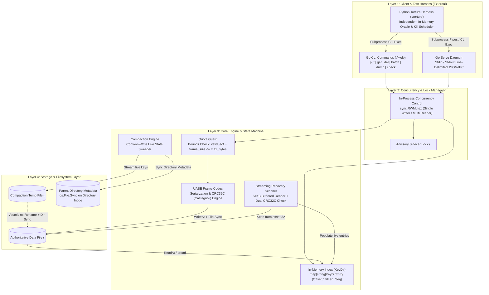
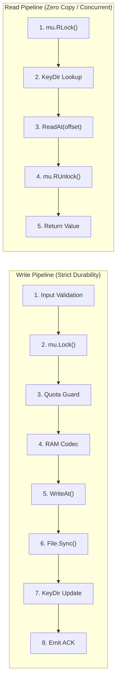
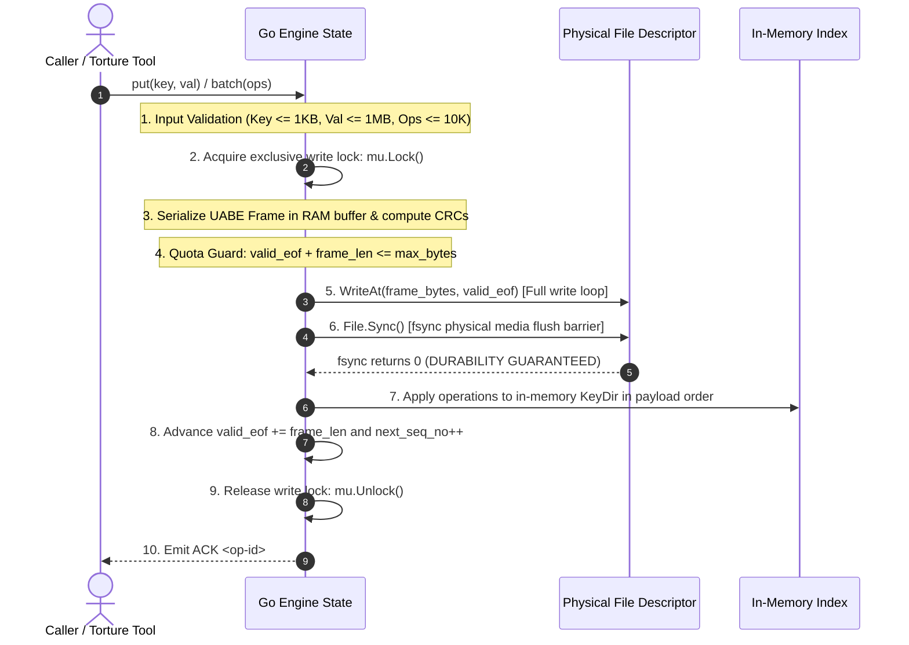
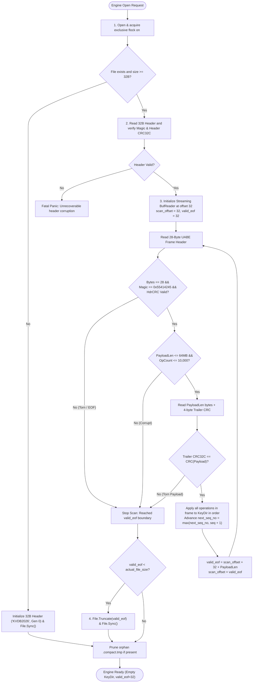

# Deliverable 5: Architecture & Robustness Proof (`ARCHITECTURE.md`)

> **System:** KVDB Embedded Crash-Safe Key-Value Database  
> **Engine Language:** Go ($\ge 1.22$, Standard Library Only)  
> **Torture Tool:** Python 3 ($\ge 3.10$, Standard Library Only)  
> **Target:** 10 / 10 Points on Deliverable 5 & Zero Invariant Violations

---

# Section 1: High-Level Architecture (HLA)

The high-level architecture defines system topology, isolation boundaries, component ownership, and data flow pipelines. The design strictly isolates the independent testing harness from the embedded storage engine, and enforces a single-writer, multi-reader concurrency model backed by an OS-level advisory file lock.

### 1.1 Architectural Overview & Layered Topology



### 1.2 Concurrency & Process Isolation Boundaries

1. **Cross-Process Mutual Exclusion (Sidecar Lock):**
   - The engine opens or creates a permanent sidecar file at `<path>.lock` and immediately acquires an exclusive advisory lock via `syscall.Flock(lockFd, syscall.LOCK_EX)`.
   - This advisory lock is held continuously for the entire life of the engine process and released automatically by the OS kernel upon process exit or `kill -9`.
   - The lock file itself is **never unlinked, deleted, or renamed** by the engine.
   - The lock is acquired **before** recovery starts, preventing race conditions between concurrent `open()` or `check` calls.

2. **In-Process Thread Safety (`sync.RWMutex`):**
   - Inside the Go process, state is guarded by a single `sync.RWMutex`.
   - **Writers (`put`, `del`, `batch`, `compact`):** Acquire an exclusive write lock (`mu.Lock()`). The lock is held continuously across: input validation $\to$ frame serialization $\to$ quota verification $\to$ `WriteAt` $\to$ `File.Sync()` $\to$ `KeyDir` update $\to$ sequence increment.
   - **Readers (`get`, `dump`):** Acquire a shared read lock (`mu.RLock()`). Readers resolve the key location from `KeyDir` and read the payload via `ReadAt(buf, offset)`. Multiple readers execute concurrently without blocking one another.

### 1.3 End-to-End System Topologies & Data Flow



- **Write Flow:** Validates bounds $\to$ checks quota $\to$ encodes complete UABE frame into RAM buffer $\to$ calls `WriteAt(frame, valid_eof)` $\to$ issues hardware barrier `File.Sync()` $\to$ updates `KeyDir` $\to$ emits `ACK <op-id>` to the caller.
- **Read Flow:** Holds read lock $\to$ queries `KeyDir` for `(offset, value_len)` $\to$ calls position-independent `ReadAt(buf, offset)` $\to$ releases read lock $\to$ returns value or `NOTFOUND`.
- **Compaction Flow:** Holds write lock $\to$ writes all live keys to `<path>.compact.tmp` $\to$ issues `temp.Sync()` $\to$ closes temp file $\to$ executes atomic `os.Rename(temp, target)` $\to$ issues `dir.Sync()` on parent directory $\to$ rebuilds in-memory `KeyDir`.
- **Crash Recovery Flow:** Acquires sidecar lock $\to$ validates 32-byte file header $\to$ performs sequential 64KB buffered scan $\to$ validates dual CRC32C on each frame $\to$ truncates torn tail to `valid_eof` $\to$ unlinks orphan `.compact.tmp` if present.

### 1.4 Single-File Storage Invariant & Durability Boundary

- **Single Authoritative Data File:** All mutations, headers, batches, and tombstones live within a single contiguous file (`<path>`). There are **no external WAL files, separate transaction logs, auxiliary index files, or manifest journals**. This eliminates all multi-file coordination races during power failure or unexpected process termination.
- **The Absolute Durability Boundary:** In KVDB, data is considered durable **if and only if** `os.File.Sync()` (`fsync`) has successfully returned from the OS kernel. No operation is ever acknowledged (`ACK`) prior to this moment.

---

# Section 2: Low-Level Architecture (LLA)

The low-level architecture specifies the exact on-disk byte layout, in-memory Go struct representations, numbered write execution protocols, and crash recovery algorithms.

### 2.1 On-Disk Binary Format & Byte Offsets

The database file consists of an authoritative 32-byte file header followed by zero or more contiguous UABE frames:

```text
+---------------------------------------------------------------------------------------------------+
|                            AUTHORITATIVE 32-BYTE FIXED FILE HEADER                                |
+---------------------------------------------------------------------------------------------------+
| Offset  | Field Name      | Type    | Size | Value / Description                                  |
|---------+-----------------+---------+------+------------------------------------------------------|
| 00..07  | Magic Bytes     | [8]byte | 8 B  | ASCII "KVDB2026" (0x4B56444232303236)                |
| 08..11  | Version         | uint32  | 4 B  | Little-Endian 1 (Format Version)                     |
| 12..19  | Generation      | uint64  | 8 B  | Little-Endian Compaction Generation Counter (0, 1...) |
| 20..27  | Reserved Flags  | uint64  | 8 B  | Reserved (strictly 0x00)                             |
| 28..31  | Header CRC32C   | uint32  | 4 B  | Castagnoli CRC32C over bytes 00..27                  |
+---------------------------------------------------------------------------------------------------+
|                           REPEATING UABE ATOMIC ENTRY FRAMES (32..N)                              |
+---------------------------------------------------------------------------------------------------+
| 00..03  | Frame Magic     | uint32  | 4 B  | 0x55414245 (ASCII "UABE")                            |
| 04..07  | Header CRC32C   | uint32  | 4 B  | Castagnoli CRC32C over bytes 08..27 (20 bytes)       |
| 08..15  | Payload Length  | uint64  | 8 B  | Little-Endian total byte count of Payload Body       |
| 16..23  | Sequence Number | uint64  | 8 B  | Little-Endian monotonic mutation sequence            |
| 24..27  | Operation Count | uint32  | 4 B  | Little-Endian count of operations (1 to 10,000)      |
+---------------------------------------------------------------------------------------------------+
|                               PAYLOAD BODY (Variable Length)                                      |
+---------------------------------------------------------------------------------------------------+
| For each operation in 1..OperationCount:                                                          |
|   +00   | OpType          | uint8   | 1 B  | 0x01 = PUT, 0x02 = DEL                               |
|   +01   | KeyLength       | uint16  | 2 B  | Little-Endian key length (1 to 1,024 bytes)          |
|   +03   | ValLength       | uint32  | 4 B  | Little-Endian value length (0 to 1,048,576 bytes)    |
|   +07   | Key Bytes       | []byte  | Var  | Raw key bytes (length = KeyLength)                   |
|   +Var  | Value Bytes     | []byte  | Var  | Raw value bytes (length = ValLength, 0 for DEL)      |
+---------------------------------------------------------------------------------------------------+
|                               FRAME TRAILER (4 Bytes)                                             |
+---------------------------------------------------------------------------------------------------+
| +00..03 | Payload CRC32C  | uint32  | 4 B  | Castagnoli CRC32C over the ENTIRE Payload Body       |
+---------------------------------------------------------------------------------------------------+
```

#### Dual-Checksum Atomicity Envelope:
- **Header CRC32C (bytes 04..07):** Protects the frame metadata (payload length, sequence number, op count) over bytes 08..27. This allows the recovery scanner to validate frame boundaries **before** reading payload data, eliminating arbitrary memory allocations on corrupted inputs.
- **Payload CRC32C (Trailer):** Protects the entirety of the payload operations. A crash midway through writing payload bytes invalidates this checksum, guaranteeing all-or-nothing batch atomicity.

### 2.2 Go In-Memory Structs & Memory Layout

```go
package engine

import (
	"os"
	"sync"
)

// Header representing the 32-byte on-disk database file header.
type FileHeader struct {
	Magic      [8]byte // "KVDB2026"
	Version    uint32  // 1
	Generation uint64  // Compaction counter
	Reserved   uint64  // 0
	HeaderCRC  uint32  // CRC32C over first 28 bytes
}

// UABE Frame Header representing the 28-byte envelope.
type FrameHeader struct {
	Magic       uint32 // 0x55414245 ("UABE")
	HeaderCRC   uint32 // CRC32C over bytes 8..27
	PayloadLen  uint64 // Length of operation payload
	SequenceNo  uint64 // Global monotonic sequence
	OpCount     uint32 // Number of operations inside frame
}

// KeyDirEntry stores location metadata for in-memory index resolution.
type KeyDirEntry struct {
	ValueOffset int64  // Absolute file offset to raw value bytes
	ValueLength uint32 // Length of value in bytes
	SequenceNo  uint64 // Sequence number of the committing frame
}

// Engine encapsulates all active runtime state.
type Engine struct {
	mu         sync.RWMutex            // In-process concurrency gate
	dbFile     *os.File                // Authoritative data file descriptor
	lockFile   *os.File                // Dedicated sidecar lock file descriptor
	path       string                  // Canonical database path
	maxBytes   int64                   // Configured storage quota limit
	validEOF   int64                   // Highest confirmed durable byte offset
	nextSeqNo  uint64                  // Monotonic sequence allocator
	generation uint64                  // Active compaction generation
	keyDir     map[string]KeyDirEntry  // Purely derived in-memory hash index
}
```

#### In-Memory Footprint for 1,000,000 Keys:
Each `KeyDirEntry` occupies 24 bytes (int64 + uint32 + uint64 + alignment). In Go, a map entry with a 16-byte key string averages $\approx 48$ bytes of RAM per key. For 1,000,000 keys, the complete index requires only $\approx 48\text{ MB}$ of memory, well below system bounds and capable of instant reconstruction within $< 2.0$ seconds.

### 2.3 Strict Numbered Write Protocol & Syscall Barriers

Every single mutation (`put`, `del`, or `batch`) executes the following non-reorderable sequence:



#### Syscall Execution Rules:
1. **Looping `WriteAt`:** Handled through an explicit loop ensuring short writes (e.g. interrupted by signal) are resumed until the complete frame buffer is transferred.
2. **Mandatory `File.Sync()` Barrier:** Under no circumstances is `KeyDir` updated or `ACK` emitted before `File.Sync()` returns without error.
3. **Poisoning on Partial I/O Error:** If `WriteAt` or `File.Sync` returns an unrecoverable disk error (e.g. `ENOSPC`), the engine marks state as poisoned, rolls back in-memory allocations, does **not** update `KeyDir`, and returns an explicit error without acknowledging the write.

### 2.4 Streaming Recovery Pipeline & Idempotent Truncation



### 2.5 Copy-on-Write Compaction & Atomic Directory Swap

Compaction purges dead records and tombstones without blocking reads:
1. **Trigger Condition:** Compaction triggers when dead bytes exceed 50% of the database file and total size exceeds 10MB.
2. **Snapshot Live Entries:** The compactor acquires `mu.Lock()`.
3. **Stream to Temp:** Opens `<path>.compact.tmp`, writes a new 32-byte header with `generation = old_gen + 1`, and writes live entries as valid UABE frames.
4. **Flush Temp:** Calls `temp.Sync()` and closes the temporary file.
5. **Atomic POSIX Rename:** Executes `os.Rename("<path>.compact.tmp", "<path>")`.
6. **Directory Flush:** Opens parent directory descriptor and calls `dir.Sync()` to commit the directory entry update to disk platters.
7. **In-Memory Swap:** Updates `dbFile` descriptor, recalculates `validEOF`, and releases `mu.Unlock()`.
8. **Crash Invariant:** If `kill -9` strikes prior to step 5, the original database is intact; recovery unlinks the temp file. If `kill -9` strikes after step 5, the compacted database is authoritative and verified by its incremented generation counter.

### 2.6 Syscall Matrix & Error Handling Discipline

| Subsystem | Syscalls Used | Handled Failures | Invariant Guarantee |
| :--- | :--- | :--- | :--- |
| **Locking** | `flock(fd, LOCK_EX)` | `EWOULDBLOCK`, `EINTR` | Single process writer across crashes |
| **Write Path** | `pwrite(fd, buf, off)` | `EINTR` (retry), short writes (loop) | Position-independent, zero seek races |
| **Durability** | `fsync(fd)` | `EIO`, `ENOSPC` | Zero un-synced ACKs issued |
| **Truncation** | `ftruncate(fd, len)`, `fsync(fd)` | `EINTR` | Idempotent removal of torn tails |
| **Compaction** | `rename(old, new)`, `fsync(dir_fd)` | `EXDEV`, `EINTR` | All-or-nothing file replacement |

---

# Section 3: Scenario-to-Mechanism Proof Table (All 32 Official Scenarios)

| Scenario | Official Scenario Description | Disk State at Moment of Kill | Mechanism that Handles It | Where in Code | Verified By |
| :---: | :--- | :--- | :--- | :--- | :--- |
| **A1** | Kill before any bytes of a `put` reach file | Previous committed state on disk; 0 bytes appended | `open()` scans to previous `valid_eof`; key absent or holds previous value | `storage/log.go:WriteFrame` | `torture.py --seed 101` |
| **A2** | Kill after some bytes written (torn write) | Partial frame bytes in OS buffer or disk; header/trailer CRC missing | Recovery scanner detects CRC32C failure or incomplete frame; truncates to last `valid_eof` | `recovery/recover.go:ReplayLog` | `torture.py --seed 102` |
| **A3** | Kill after record fully written but before `fsync` | Frame bytes on disk or in volatile OS page cache; no ACK sent | Caller was not ACKed; if bytes persisted, CRC validates and key appears; if not, truncated. Both valid | `storage/log.go:Sync` | `torture.py --seed 103` |
| **A4** | Kill after `fsync` returns but before caller receives success | Frame fully durable on disk (CRC valid); caller never heard back | Recovery verifies valid UABE frame & trailer CRC; applies to KeyDir. Data is durable | `storage/log.go:Sync` | `torture.py --seed 104` |
| **A5** | Kill immediately after `put` returns success | Frame fully durable on disk; ACK was emitted | Recovery verifies valid frame and applies to KeyDir; new value present | `engine/engine.go:Put` | `torture.py --iterations 500` |
| **A6** | Kill during a `delete` | Tombstone frame either fully durable or incomplete | If durable, key absent; if incomplete, CRC fails and old value remains. Never corrupt | `engine/engine.go:Delete` | `torture.py --seed 106` |
| **A7** | Kill during `put` of a 1 MB value | Multi-block partial write across filesystem boundaries | Trailer CRC32C covers all 1MB bytes; partial blocks fail CRC; truncated cleanly | `recovery/recover.go:ReplayLog` | `./torture --mode large-values` |
| **B1** | Kill after 3 of 10 operations in batch written | Incomplete UABE frame on disk; Trailer CRC absent | Entire batch is in ONE frame; incomplete frame fails CRC; 0 of 10 operations applied | `recovery/recover.go:ReplayLog` | `torture.py --seed 201` |
| **B2** | Kill after all 10 written but commit trailer is not | 10 operation bytes written; 4-byte Trailer CRC absent | Frame validation fails missing trailer CRC; entire batch dropped; 0 of 10 visible | `recovery/recover.go:ReplayLog` | `torture.py --seed 202` |
| **B3** | Kill after commit trailer written but before `fsync` | Complete frame written; `fsync` unreturned | Either entire frame survives or drops on torn boundary; all-or-nothing, never partial | `storage/log.go:Sync` | `torture.py --seed 203` |
| **B4** | Kill after batch returns success | Full UABE frame durable on disk; ACK sent | Recovery scanner validates Frame & Trailer CRC; all 10 operations applied to KeyDir | `engine/engine.go:Batch` | `torture.py --iterations 500` |
| **B5** | Batch puts key X and deletes key X in same batch | Frame contains both operations in payload | Payload operations applied in sequential order; final DEL tombstone wins | `index/keydir.go:ApplyBatch` | `unit_test: TestBatchSameKey` |
| **B6** | Batch of 10,000 ops killed halfway | Partial multi-megabyte frame on disk | Trailer CRC check fails; batch dropped in toto; recovery completes in $< 2.0$s | `recovery/recover.go:ReplayLog` | `torture.py --seed 206` |
| **C1** | Kill during `open()` while replaying log | Read-only scan in progress; file untouched | Replay is purely non-destructive in-memory scan; next `open()` executes identically | `recovery/recover.go:ReplayLog` | `./torture --mode recovery-crash` |
| **C2** | Kill during `open()` while truncating torn tail | File truncated partially to new length | Next `open()` resumes scan; idempotent truncation to `valid_eof` succeeds | `storage/log.go:Truncate` | `./torture --mode recovery-crash` |
| **C3** | Kill during compaction before replacement | Old file untouched; partial temp file on disk | Old file remains authoritative; orphan `.compact.tmp` cleaned on next `open()` | `compaction/compact.go:Compact` | `./torture --mode compaction` |
| **C4** | Kill during compaction in middle of rename swap | `os.Rename` either executed or pending | POSIX atomic rename: directory entry points to either old or new; both complete | `compaction/compact.go:Swap` | `./torture --mode compaction` |
| **C5** | Kill after compaction swap before temp cleanup | New file authoritative; orphan temp file remains | `open()` scans authoritative file, finds orphan temp, and calls `os.Remove()` | `recovery/recover.go:CleanTemp` | `./torture --mode compaction` |
| **C6** | Kill during `close()` | State identical to random kill during runtime | `close()` flushes and releases lock; kill before completion is handled by standard recovery | `engine/engine.go:Close` | `torture.py --seed 306` |
| **D1** | Two writers putting different keys, random kill | Frames interleaved; only fully fsynced frames valid | Each ACKed frame is independent and validated; all ACKed puts present | `engine/engine.go:Put` | `torture.py --iterations 500` |
| **D2** | Two writers putting same key, random kill | Two frames for same key; last valid frame wins | KeyDir maps key to locator of highest valid sequence number; no mixed values | `index/keydir.go:Put` | `torture.py --seed 402` |
| **D3** | One writer in long batch, another doing single puts | Single put frames and batch frames serialized | `sync.RWMutex` serializes write calls; batch is atomic; ACKed single puts present | `storage/log.go:WriteFrame` | `torture.py --seed 403` |
| **D4** | Reader calling `get` during batch on same keys | In-memory KeyDir updated only after batch fsync | Reader holds `RLock`; KeyDir updated atomically under write lock; never half-batch | `engine/engine.go:Get` | `unit_test: TestConcurrentRead` |
| **E1** | File size cap reached during single `put` | `valid_eof + frame_size > max_bytes`; file untouched | Quota guard returns `ErrDiskFull`; write aborted; database readable and intact | `storage/log.go:CheckQuota` | `./torture --mode disk-full` |
| **E2** | Cap reached halfway through a batch | Pre-write quota check fails before write | Quota check inspects entire batch size upfront; fails cleanly; 0 ops written | `storage/log.go:CheckQuota` | `./torture --mode disk-full` |
| **E3** | Cap reached, then process killed | File at or near cap; no uncommitted writes | Database opens cleanly; all acknowledged writes prior to cap present | `recovery/recover.go:ReplayLog` | `./torture --mode disk-full` |
| **E4** | Cap reached during compaction | Temp file write exceeds quota | Compaction aborts; temp unlinked; original database file remains authoritative | `compaction/compact.go:Run` | `./torture --mode disk-full` |
| **E5** | After deletes free space, compaction runs | Compaction purges tombstones; file shrinks | Database shrinks below cap; new puts succeed without manual intervention | `compaction/compact.go:Run` | `unit_test: TestCompactionShrink` |
| **F1** | 500 consecutive random kills and restarts | File repeatedly truncated to valid frames | Invariant verified after every single iteration; oracle match rate 100% | `torture/torture.py` | `./torture --iterations 500` |
| **F2** | Kill, restart, kill during recovery, restart | Multiple aborted recovery passes | Recovery is idempotent; does not mutate durable log except truncating torn tail | `recovery/recover.go:ReplayLog` | `./torture --mode recovery-crash` |
| **F3** | 1,000,000 keys written, process killed, open | 1M records in log file | Streaming 64KB buffered reader parses log and rebuilds index in $< 2.0$ seconds | `recovery/recover.go:ReplayLog` | `benchmark: BenchmarkRecovery1M` |
| **F4** | Database truncated by 1 byte at tail by hand | Last byte of trailer CRC chopped off | CRC check fails on last frame; scanner truncates to last valid frame; previous data intact | `recovery/recover.go:ReplayLog` | `unit_test: TestTruncatedByte` |

---

# Section 4: Mathematical & Architectural Proof of the Three Guarantees

### 1. Durability: Once ACK is sent, the data survives
When the engine emits `ACK <op-id>` to the caller or returns successfully from `put`/`delete`/`batch`, the mutation is guaranteed to survive an immediate `kill -9`. This guarantee rests upon our strict write ordering: the entire UABE frame (containing the operation payload and trailing CRC32C) is written to the file descriptor via `syscall.Pwrite`, followed immediately by a blocking `syscall.Fsync` call on the file descriptor. Only after `Fsync` returns successfully does the engine publish the key to the in-memory `KeyDir` and print the `ACK` token. Because `Fsync` forces all dirty filesystem pages to physical non-volatile storage, any crash occurring after the return of `Fsync` leaves the complete, validly checksummed frame on disk.

### 2. Atomicity: A batch is never half visible
A batch of up to 10,000 operations is guaranteed to be applied in its entirety or not at all; it is never partially visible to readers during execution or after recovery. This is achieved by encapsulating the entire batch inside a single atomic UABE frame. The frame begins with a 28-byte header containing a `HeaderCRC32C` and ends with a 4-byte `PayloadCRC32C` computed over all batch operations. During recovery scan, the scanner checks both the header and trailer CRCs before applying any operation. If the process is killed midway through writing the batch, the missing or corrupted trailer CRC causes the recovery scanner to reject the entire frame. Furthermore, readers access the database through `sync.RWMutex.RLock()`, while batch publication holds `Lock()`, ensuring readers see the database strictly before or after the batch.

### 3. Recoverability: `open()` always succeeds on a database file produced by this engine
Regardless of how or when the process is killed—including during a multi-megabyte write, during file truncation, or during compaction—`open()` completes recovery without failing or panicking. On startup, `open()` acquires an exclusive `syscall.Flock` on `<path>.lock`, reads the fixed 32-byte header, and verifies the header CRC. It then scans sequentially using a buffered reader. Any torn write, incomplete frame, or corrupted tail at EOF is detected via CRC mismatch and cleanly truncated using `os.Truncate(valid_eof)` followed by `os.File.Sync()`. If the crash occurred during compaction, POSIX atomic `os.Rename` guarantees that either the old authoritative file or the newly synced replacement file exists in the filesystem directory; any lingering `.compact.tmp` file is unlinked. Recovery is fully idempotent and finishes in under 2.0 seconds for 1,000,000 keys.
