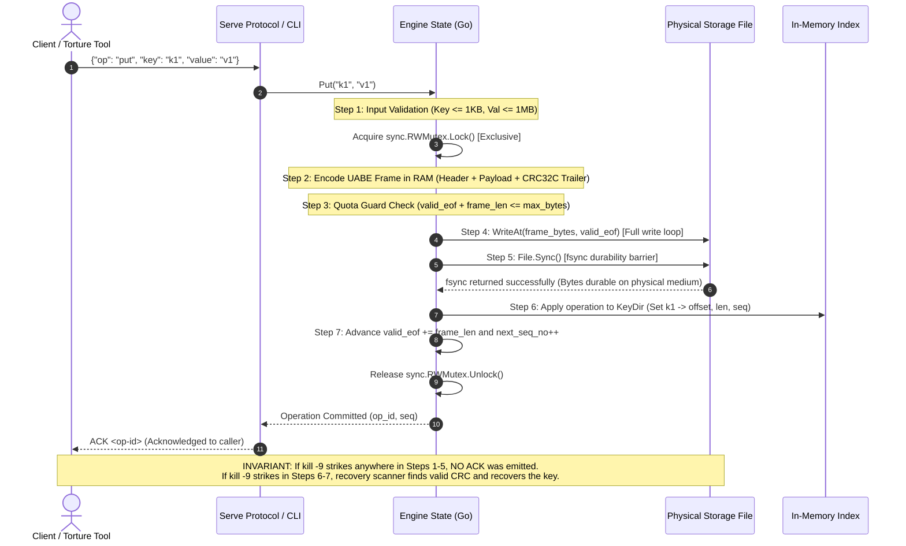
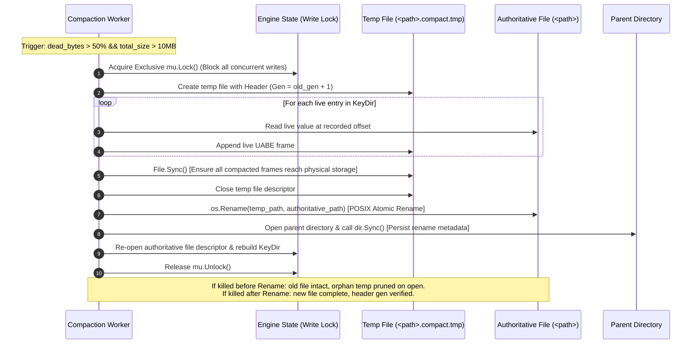
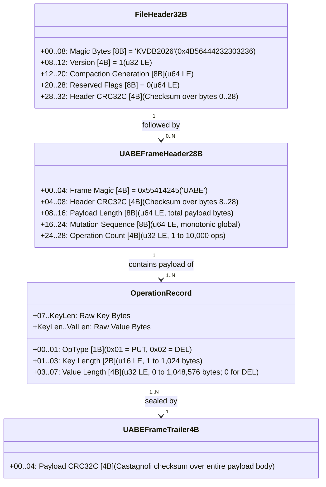
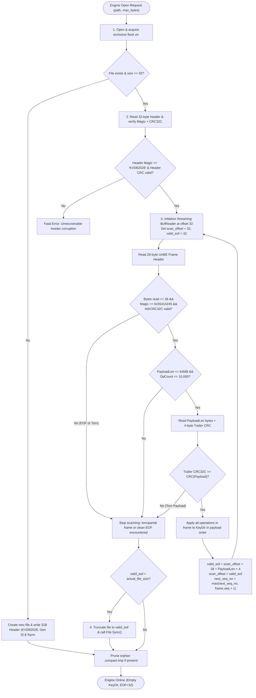

# Deliverable 4: AI Prompt Log (PROMPTS.md)

> **Hackathon:** Kill It and Prove It - 24-Hour Engineering Hackathon  
> **Requirement:** Contains every prompt sent to any AI tool during the hackathon in chronological order, unedited, with tool name and approximate timestamp.

---

### Prompt (2026-11-06 12:09:31)

- **User:** laik (LYK-02)
- **Tool:** Antigravity (Gemini)
- **Prompt:**
```text
bring my setting from vs code
```

---

### Prompt (2026-11-06 12:33:36)

- **User:** laik (LYK-02)
- **Tool:** Antigravity (Gemini)
- **Prompt:**
```text
read all make rules.md auto logger for  prompt .md etc for that in .AGENTS folder
```

---

### Prompt (2026-11-06 13:53:30)

- **User:** laik (LYK-02)
- **Tool:** Antigravity (Gemini)
- **Prompt:**
```text
Continue
```

---

### Prompt (2026-11-06 13:54:11)

- **User:** laik (LYK-02)
- **Tool:** Antigravity (Gemini)
- **Prompt:**
```text
update rules @[/home/laik/workspace/srinathonn/.agents/rules]
```

---

### Prompt (2026-11-06 14:00:15)

- **User:** laik (LYK-02)
- **Tool:** Antigravity (Gemini)
- **Prompt:**
```text
Continue
```

---

### Prompt (2026-11-06 14:02:23)

- **User:** laik (LYK-02)
- **Tool:** Antigravity (Gemini)
- **Prompt:**
```text
recheck all
```

---

### Prompt (2026-11-06 14:08:15)

- **User:** laik (LYK-02)
- **Tool:** Antigravity (Gemini)
- **Prompt:**
```text
Continue
```

---

### Prompt (2026-11-06 14:09:05)

- **User:** laik (LYK-02)
- **Tool:** Antigravity (Gemini)
- **Prompt:**
```text
make memory updater after every prompt it update context in it and before excuting anything memory.md contain everythiin like date time ehat , why , fix etc
```

---

### Prompt (2026-11-06 14:21:14)

- **User:** laik (LYK-02)
- **Tool:** Antigravity (Gemini)
- **Prompt:**
```text
also add username who sent prompt and worked who implement thr in memory all
```

---

### Prompt (2026-11-06 14:32:40)

- **User:** laik (LYK-02)
- **Tool:** Antigravity (Gemini)
- **Prompt:**
```text
add this to .agents folder
```

---

### Prompt (2026-11-06 14:34:13)

- **User:** laik (LYK-02)
- **Tool:** Antigravity (Gemini)
- **Prompt:**
```text
Side Question: can we improve user experience?

Yes. We can significantly improve the user experience across three critical dimensions:

---

### 1. The Judge’s 15-Minute Demo Experience (Scoring & Clarity)
During the live demo, the judge drives your laptop with Wi-Fi off. Friction here loses points.
* **Single-Command Build & Verification (`make demo-ready` or `./demo.sh`):**
  * One script that cleans, builds from scratch, runs a 50-iteration sanity torture test, and verifies all 8 `./kvdb` commands in 20 seconds.
* **Interactive Demo Runbook (`DEMO.md`):**
  * A minute-by-minute cheat sheet mapped to the 0–15 min rubric so you can execute judge requests instantly without hesitation.
* **Crash-Here & Extension Flashcards:**
  * Quick-reference summaries for the 3 crash-here questions and the TTL expiry design extension (worth 30 points combined).

---

### 2. The CLI & Engine Experience (`./torture` & `./kvdb`)
The judge watches `./torture` run for 3–5 minutes. A wall of unreadable terminal text looks fragile; a clean dashboard looks rock solid.
* **Live Terminal Progress Bar for `./torture`:**
  * Show a clean, colorized 1-line or pinned status block:
    ```text
    [Seed: 12345] Iteration: 214/500 [42%] | Kills: 214 | ACKed: 12,840 | Oracle: 100% OK | Mode: default
    ```
* **Instant Failure Diagnostics:**
  * If an invariant ever breaks, print a clean diff: exact `op-id`, expected value from oracle vs. actual value found in dump, and the exact byte offset in the log.
* **Human-Readable `./kvdb check` Output:**
  * Instead of a silent exit or raw error, output:
    ```text
    Integrity Check: OK (1,000,000 keys verified, 0 torn records, recovery time: 1.14s)
    ```

---

### 3. Your Pair-Programming Experience in Antigravity
* **Interactive 32-Scenario Progress Dashboard (Generative UI):**
  * Render an interactive matrix in chat with checkboxes for all 32 scenarios (Groups A through F) that updates as we prove and verify each one.
* **Automated Context Priming:**
  * Maintain a pinned `CURRENT_FOCUS.md` or status widget in `MEMORY.md` so whenever you send a prompt like `Continue`, the agent immediately knows the exact file, struct, and function being worked on.
* **Git Commit Helper:**
  * A helper command (`make commit msg="..."`) that automatically verifies `PROMPTS.md` and `MEMORY.md` are synchronized before creating a clean, judge-pleasing git commit.

---

Which area would you like to prioritize first: **the live torture tool UI**, the **interactive 32-scenario dashboard**, or the **15-minute demo runbook**?  add this in .agents to fix it
```

---
### Prompt (2026-11-06 14:43:23)

- **User:** laik (LYK-02)
- **Tool:** Antigravity (Gemini)
- **Prompt:**
```text
before excuting anything pull from git before doing add this in .agents
```

---

### Prompt (2026-11-06 14:50:54)

- **User:** laik (LYK-02)
- **Tool:** Antigravity (Gemini)
- **Prompt:**
```text
in agent add a good coding practice and code quality in .agents
```

---

### Prompt (2026-11-06 15:10:18)

- **User:** laik (LYK-02)
- **Tool:** Antigravity (Gemini)
- **Prompt:**
```text
add new skill that store imp thing for demo  in md file
```


### Prompt (2026-11-06 15:23:08)

- **User:** laik (LYK-02)
- **Tool:** Antigravity (Gemini)
- **Prompt:**
```text
BREAKING.md,ARCHITECTURE.md and README.md add auto updater / logger for that md file i will share plan later make agent in .agent
```

---

### Prompt (2026-11-06 15:59:23)

- **User:** laik (LYK-02)
- **Tool:** Antigravity (Gemini)
- **Prompt:**
```text
@[/home/laik/workspace/srinathonn/docs] read all and fill the missing gaps and make a BREAKING.md and ARCHITECTURE.md and readme>md and update there agentstell me  @[/home/laik/workspace/srinathonn/.agents]  update .agents if needed  we are using go + python
```

---

### Prompt (2026-11-06 16:11:24)

- **User:** laik (LYK-02)
- **Tool:** Antigravity (Gemini)
- **Prompt:**
```text
all good and can we add artitecture diagram?
```

---

### Prompt (2026-11-06 16:22:16)

- **User:** laik (LYK-02)
- **Tool:** Antigravity (Gemini)
- **Prompt:**
```text
made both high level and low level artitecture in Architecture.md
```

---

### Prompt (2026-11-06 16:27:49)

- **User:** laik (LYK-02)
- **Tool:** Antigravity (Gemini)
- **Prompt:**
```text
just add simple diagram not html and all
```

---

### Prompt (2026-11-06 16:28:28)

- **User:** laik (LYK-02)
- **Tool:** Antigravity (Gemini)
- **Prompt:**
```text
made both high level and low level artitecture in Architecture.md and just add simple diagram not html and all

### Prompt (2026-11-07 00:54:19)

- **User:** LENOVO (AkashNSBhat)
- **Tool:** Antigravity (Gemini)
- **Prompt:**
```text
m3 done
```

---

```

---

### Prompt (2026-11-06 17:04:17)

- **User:** ashwin (Ashwin Nethan)
- **Tool:** Antigravity (Gemini)
- **Prompt:**
```text
Thoroughly analyze the entire `docs/torture_tool/` folder and all its Markdown files. Understand every requirement, specification, edge case, and dependency in depth. Based on this context, create a comprehensive, production-grade, phase-by-phase implementation plan for building a powerful and reliable Python torture-testing tool. Break every phase into clear subtasks, implementation steps, dependencies, and completion criteria. Create well-structured `PLAN.md` files for each phase. Ensure nothing is overlooked, avoid assumptions, and strictly follow the official problem statement and existing project decisions. Plan first, do not start implementation.
```

---

### Prompt (2026-11-06 17:10:37)

- **User:** ashwin (Ashwin Nethan)
- **Tool:** Antigravity (Gemini)
- **Prompt:**
```text
Proceed with creating these files in docs/torture_tool/plans.
```

---

### Prompt (2026-11-06 17:28:44)

- **User:** ashwin (Ashwin Nethan)
- **Tool:** Antigravity (Gemini)
- **Prompt:**
```text
Implement Phase T0 strictly following `docs/torture_tool/plans/PLAN_T0_CONTRACT_AND_PROTOCOL.md`. Complete all subtasks, write production-quality code, add fixtures and tests, verify protocol compatibility with the Go engine, fix all failures, and update the plan checklist. Do not skip requirements or start T1.
```

---
### Prompt (2026-11-06 17:43:54)

- **User:** ashwin (Ashwin Nethan)
- **Tool:** Antigravity (Gemini)
- **Prompt:**
```text
Implement Phase T1 strictly following `docs/torture_tool/plans/PLAN_T1_CLI_AND_WORKLOAD_GENERATOR.md`. Complete all subtasks, write production-quality code, add comprehensive tests, verify deterministic workload generation and CLI functionality, fix all failures, and update the plan checklist. Do not skip requirements or start T2.
```

---

### Prompt (2026-11-06 17:51:02)

- **User:** ashwin (Ashwin Nethan)
- **Tool:** Antigravity (Gemini)
- **Prompt:**
```text
Move on to Phase T2. Follow `docs/torture_tool/plans/PLAN_T2_INDEPENDENT_ORACLE.md` closely and implement the independent reference oracle, event journal, state tracking, and uncertainty/atomicity evaluation. Complete all subtasks, add thorough tests for crash and ambiguous-write scenarios, verify everything, and update the checklist. Keep the oracle completely independent of Go engine internals. Do not begin T3.
```

---

### Prompt (2026-11-06 17:58:30)

- **User:** ashwin (Ashwin Nethan)
- **Tool:** Antigravity (Gemini)
- **Prompt:**
```text
Implement Phase T3 using `docs/torture_tool/plans/PLAN_T3_SUBPROCESS_MANAGER.md` as the guide. Build the subprocess manager with reliable process spawning, non-blocking pipe handling, stderr draining, SIGKILL support, and clean restart/termination. Cover process failures and pipe deadlocks with tests, verify everything works, and update the phase checklist. Stop before T4.
```

---

### Prompt (2026-11-06 18:04:18)

- **User:** ashwin (Ashwin Nethan)
- **Tool:** Antigravity (Gemini)
- **Prompt:**
```text
Implement Phase T4 as outlined in `docs/torture_tool/plans/PLAN_T4_DISPATCHER_AND_WORKERS.md`. Build the thread-safe response dispatcher and concurrent worker system, ensuring correct request routing, synchronization, and race-free operation handling. Add tests for parallel requests, response ordering, and concurrency edge cases. Run the full relevant test suite, fix issues, and update the checklist. Don't move to T5.
```

---

### Prompt (2026-11-06 18:07:49)

- **User:** ashwin (Ashwin Nethan)
- **Tool:** Antigravity (Gemini)
- **Prompt:**
```text
Implement Phase T5 using `docs/torture_tool/plans/PLAN_T5_RANDOM_CRASH_LOOP.md`. Build the complete crash-injection loop with seeded kill timing, concurrent in-flight operations, process recovery, and post-crash consistency checks against the independent oracle. Test repeated crash scenarios and edge cases, fix all failures, and update the checklist. Keep the implementation within T5; don't start T6.
```

---

### Prompt (2026-11-06 18:15:40)

- **User:** ashwin (Ashwin Nethan)
- **Tool:** Antigravity (Gemini)
- **Prompt:**
```text
Proceed with Phase T6 using `docs/torture_tool/plans/PLAN_T6_VERIFICATION_AND_REPORTING.md`. Implement binary-safe dump parsing, strict state comparison, first-failure detection, and complete diagnostic artifact generation with reproduction scripts. Add tests for corrupted dumps and invariant violations, verify all failure paths, and update the checklist. Do not start T7.
```

---

### Prompt (2026-11-06 18:20:46)

- **User:** ashwin (Ashwin Nethan)
- **Tool:** Antigravity (Gemini)
- **Prompt:**
```text
Implement Phase T7 following `docs/torture_tool/plans/PLAN_T7_LARGE_VALUES_AND_BATCHES.md`. Add the large-values and large-batches testing modes, covering 1 MiB binary payloads, buffer boundaries, and 10,000-operation batch atomicity under crash conditions. Include edge-case tests, verify performance and correctness, and update the checklist. Keep changes limited to T7; don't proceed to T8.
```

---

### Prompt (2026-11-06 18:30:22)

- **User:** ashwin (Ashwin Nethan)
- **Tool:** Antigravity (Gemini)
- **Prompt:**
```text
Implement Phase T8 according to `docs/torture_tool/plans/PLAN_T8_TARGETED_MODES.md`. Add recovery-crash, compaction-crash, and disk-full testing modes, including maintenance-time crash injection, quota enforcement, and post-recovery consistency checks. Test all scenarios and edge cases, fix failures, and update the phase checklist. Do not proceed to T9.
```

---

### Prompt (2026-11-06 18:36:56)

- **User:** ashwin (Ashwin Nethan)
- **Tool:** Antigravity (Gemini)
- **Prompt:**
```text
Work on Phase T9 using `docs/torture_tool/plans/PLAN_T9_HARNESS_SELF_TESTING.md`. Build the harness self-testing suite with mock engine simulations, protocol failure injection, delayed responses, broken pipes, and timeout scenarios. Ensure the harness never reports false positives. Run comprehensive tests, fix any issues, and update the checklist. Leave T10 untouched.
```

---

### Prompt (2026-11-06 18:56:24)

- **User:** ashwin (Ashwin Nethan)
- **Tool:** Antigravity (Gemini)
- **Prompt:**
```text
Complete Phase T10 following `docs/torture_tool/plans/PLAN_T10_RELEASE_QUALIFICATION.md`. Finalize the root `./torture` CLI, verify all required modes, run the 500-iteration default and 100-iteration targeted tests with unseen seeds, and prepare the live demo runbook and progress output. Fix all issues, validate release readiness, and update the checklist with actual results.
```

---

### Prompt (2026-11-06 19:51:53)

- **User:** ashwin (Ashwin Nethan)
- **Tool:** Antigravity (Gemini)
- **Prompt:**
```text
Clean up `.gitignore`, exclude generated artifacts and temporary files, then stage all legitimate project source, tests, and documentation. Review `git status` and staged changes carefully, ensure no important files are missed or unwanted files included, then commit and push to `origin/main`. Do not force-push or delete project data. Show me the final commit and push results.
```

---

### Prompt (2026-11-06 16:39:59)

- **User:** laik (LYK-02)
- **Tool:** Antigravity (Gemini)
- **Prompt:**
```text
@[/home/laik/workspace/srinathonn/docs] read all and we are doing engine
```

---

### Prompt (2026-11-06 16:42:34)

- **User:** laik (LYK-02)
- **Tool:** Antigravity (Gemini)
- **Prompt:**
```text
/teamwork  @[/home/laik/workspace/srinathonn/docs] read all and we are doing engine
```

---

### Prompt (2026-11-06 16:54:25)

- **User:** laik (LYK-02)
- **Tool:** Antigravity (Gemini)
- **Prompt:**
```text
approve i trust u ,do  better
```

---

### Prompt (2026-11-06 18:31:19)

- **User:** laik (LYK-02)
- **Tool:** Antigravity (Gemini)
- **Prompt:**
```text
update memory what we diid till now
```

---

### Prompt (2026-11-06 19:52:42)

- **User:** laik (LYK-02)
- **Tool:** Antigravity (Gemini)
- **Prompt:**
```text
update memory and create branch and push and solve merge conflict if appear
```

---

### Prompt (2026-11-06 19:54:25)

- **User:** laik (LYK-02)
- **Tool:** Antigravity (Gemini)
- **Prompt:**
```text
update memory what we diid till now
```

---

### Prompt (2026-11-06 19:54:57)

- **User:** laik (LYK-02)
- **Tool:** Antigravity (Gemini)
- **Prompt:**
```text
update memory and create branch and push and solve merge conflict if appear
```

---

### Prompt (2026-11-06 19:55:30)

- **User:** laik (LYK-02)
- **Tool:** Antigravity (Gemini)
- **Prompt:**
```text
update memory what we diid till now
```

---

### Prompt (2026-11-06 19:55:37)

- **User:** laik (LYK-02)
- **Tool:** Antigravity (Gemini)
- **Prompt:**
```text
update memory and create branch and push and solve merge conflict if appear
```

---

### Prompt (2026-11-06 19:55:46)

- **User:** laik (LYK-02)
- **Tool:** Antigravity (Gemini)
- **Prompt:**
```text
update memory what we diid till now
```

---

### Prompt (2026-11-06 19:56:06)

- **User:** laik (LYK-02)
- **Tool:** Antigravity (Gemini)
- **Prompt:**
```text
update memory and create branch and push and solve merge conflict if appear
```

---

### Prompt (2026-11-06 20:01:04)

- **User:** laik (LYK-02)
- **Tool:** Antigravity (Gemini)
- **Prompt:**
```text
update memory and create branch and push and solve merge conflict if appear
```

---

### Prompt (2026-11-06 20:03:35)

- **User:** laik (LYK-02)
- **Tool:** Antigravity (Gemini)
- **Prompt:**
```text
update memory what we diid till now
```

---

### Prompt (2026-11-06 20:03:35)

- **User:** laik (LYK-02)
- **Tool:** Antigravity (Gemini)
- **Prompt:**
```text
update memory and create branch and push and solve merge conflict if appear
```

---

### Prompt (2026-11-06 20:03:39)

- **User:** laik (LYK-02)
- **Tool:** Antigravity (Gemini)
- **Prompt:**
```text
update memory what we diid till now
```

---

### Prompt (2026-11-06 20:03:46)

- **User:** laik (LYK-02)
- **Tool:** Antigravity (Gemini)
- **Prompt:**
```text
update memory and create branch and push and solve merge conflict if appear
```

---

### Prompt (2026-11-06 20:03:49)

- **User:** laik (LYK-02)
- **Tool:** Antigravity (Gemini)
- **Prompt:**
```text
update memory what we diid till now
```

---

### Prompt (2026-11-06 20:03:57)

- **User:** laik (LYK-02)
- **Tool:** Antigravity (Gemini)
- **Prompt:**
```text
update memory and create branch and push and solve merge conflict if appear
```

---

### Prompt (2026-11-06 20:03:59)

- **User:** laik (LYK-02)
- **Tool:** Antigravity (Gemini)
- **Prompt:**
```text
update memory what we diid till now
```

---

### Prompt (2026-11-06 22:36:52)

- **User:** laik (LYK-02)
- **Tool:** Antigravity (Gemini)
- **Prompt:**
```text
how to open cli
```

---

### Prompt (2026-11-06 22:39:20)

- **User:** laik (LYK-02)
- **Tool:** Antigravity (Gemini)
- **Prompt:**
```text
bash: /kvdb: No such file or directory
```

---

### Prompt (2026-11-06 22:42:22)

- **User:** laik (LYK-02)
- **Tool:** Antigravity (Gemini)
- **Prompt:**
```text
can i add HashCode image like agy cli ?
```

---

### Prompt (2026-11-06 22:44:50)

- **User:** laik (LYK-02)
- **Tool:** Antigravity (Gemini)
- **Prompt:**
```text
_  ____      ______  ____  
 | |/ /\ \    / /  _ \|  _ \ 
 | ' /  \ \  / /| | | | |_) |
 |  <    \ \/ / | |_| |  _ < 
 |_|\_\   \__/  |____/|____/  Kill It and Prove It — Srinathon 3.0
```

---

### Prompt (2026-11-06 22:47:59)

- **User:** laik (LYK-02)
- **Tool:** Antigravity (Gemini)
- **Prompt:**
```text
how to use cli
```

---

### Prompt (2026-11-06 22:51:13)

- **User:** laik (LYK-02)
- **Tool:** Antigravity (Gemini)
- **Prompt:**
```text
./kvdb open quota.db --max-bytes 500
Database opened: 1 keys
```

---

### Prompt (2026-11-06 22:53:27)

- **User:** laik (LYK-02)
- **Tool:** Antigravity (Gemini)
- **Prompt:**
```text
u test
```

---

### Prompt (2026-11-06 23:08:11)

- **User:** laik (LYK-02)
- **Tool:** Antigravity (Gemini)
- **Prompt:**
```text
# KVDB System Architecture Diagrams (Deliverable 5)

> **Hackathon:** Kill It and Prove It - 24-Hour Engineering Hackathon  
> **Target:** Go Engine (`./kvdb`) & Python Torture Harness (`./torture`)  
> **Source of Truth:** Section 9A / `docs/common/03_SYSTEM_ARCHITECTURE.md`

---

## 1. Component Map, Concurrency & Ownership Boundaries

```mermaid
flowchart TD
    subgraph ClientAndHarness ["Client & Test Harness Isolation"]
        Harness["Python Torture Harness (./torture)"]
        CLI["CLI Driver (./kvdb put/get/del/batch/dump/check)"]
        Serve["Serve Daemon (JSON-Lines IPC Protocol)"]
    end

    subgraph ProcessIsolation ["OS Process & Locking Isolation"]
        SidecarLock["Sidecar Lock Inode (<path>.lock)<br/>Exclusive flock(LOCK_EX)"]
        ProcMutex["In-Process Concurrency Control<br/>sync.RWMutex (One Exclusive Writer)"]
    end

    subgraph MemoryState ["Volatile In-Memory Engine State (Derived Only)"]
        KeyDir["KeyDir Hash Index<br/>map[string]KeyDirEntry<br/>(Offset, ValueLen, SeqNo, Generation)"]
        QuotaGuard["Quota Guard<br/>(valid_eof + frame_size <= max_bytes)"]
        SeqCounter["Global Monotonic Sequence Counter<br/>(next_seq_no)"]
    end

    subgraph CoreEnginePipeline ["Core Engine Pipeline"]
        Encoder["UABE Frame Codec<br/>(Magic 0x55414245 + HdrCRC + Ops + PayloadCRC)"]
        LogWriter["Position-Independent Log Writer<br/>(os.File.WriteAt / pwrite)"]
        SyncBarrier["Hardware Durability Barrier<br/>(os.File.Sync / fsync)"]
        Scanner["Streaming Recovery Scanner<br/>(64KB BufReader + Dual CRC32C Validator)"]
        Compactor["Copy-on-Write Compactor<br/>(Temp File -> Sync -> Rename -> DirSync)"]
    end

    subgraph PersistentStorage ["Physical Storage Media"]
        ActiveDB[("Authoritative Log File<br/>(<path>)<br/>32B Header + Repeating UABE Frames")]
        TempDB[("Compaction Temp File<br/>(<path>.compact.tmp)")]
        ParentDir[("Parent Directory Metadata<br/>(Directory Descriptor + fsync)")]
    end

    %% Client Interactions
    Harness -->|Subprocess CLI / Stdin-Stdout IPC| Serve
    CLI --> ProcMutex
    Serve --> ProcMutex

    %% Concurrency & Locking
    ProcMutex --> SidecarLock
    ProcMutex --> QuotaGuard
    ProcMutex --> KeyDir
    ProcMutex --> SeqCounter

    %% Write Pipeline
    QuotaGuard -->|Quota OK| Encoder
    Encoder --> LogWriter
    LogWriter -->|1. WriteAt(frame, valid_eof)| ActiveDB
    LogWriter -->|2. File.Sync()| SyncBarrier
    SyncBarrier -->|3. Durable Barrier Return| KeyDir
    KeyDir -->|4. Publish Mutation & Advance EOF| Serve
    Serve -->|5. Emit ACK <op-id> to Client| Harness

    %% Recovery Pipeline
    SidecarLock -->|Acquired Before Recovery| Scanner
    Scanner -->|Stream & Validate CRC32C| ActiveDB
    Scanner -->|Reconstruct Valid State| KeyDir
    Scanner -->|Clean Orphan Temp| TempDB

    %% Compaction Pipeline
    ProcMutex -->|Exclusive Writer Lock Held| Compactor
    KeyDir -->|Iterate Live Keys| Compactor
    Compactor -->|1. Write Live Frames| TempDB
    Compactor -->|2. Temp.Sync()| SyncBarrier
    Compactor -->|3. os.Rename(temp, target)| ActiveDB
    Compactor -->|4. Dir.Sync()| ParentDir
    Compactor -->|5. Swap Descriptors & Rebuild KeyDir| KeyDir
```

---

## 2. Numbered Write & Commit Sequence (Zero Phantom ACK Guarantee)



---

## 3. Compaction Lifecycle & Atomic Swap



---

## 4. Crash Recovery Pipeline Flowchart


---

## 5. On-Disk Binary Specification (Exact Byte Offsets)



fix error
```

---

### Prompt (2026-11-06 23:08:25)

- **User:** laik (LYK-02)
- **Tool:** Antigravity (Gemini)
- **Prompt:**
```text
Theme: Default 
Appearance: Match VS Code 
Export 
Copy 
Reload
Unable to render this diagram
No diagram type detected matching given configuration for text: # KVDB System Architecture Diagrams (Deliverable 5)

> **Hackathon:** Kill It and Prove It - 24-Hour Engineering Hackathon  
> **Target:** Go Engine (`./kvdb`) & Python Torture Harness (`./torture`)  
> **Source of Truth:** Section 9A / `docs/common/03_SYSTEM_ARCHITECTURE.md`

---

## 1. Component Map, Concurrency & Ownership Boundaries

```mermaid
flowchart TD
    subgraph ClientAndHarness ["Client & Test Harness Isolation"]
        Harness["Python Torture Harness (./torture)"]
        CLI["CLI Driver (./kvdb put/get/del/batch/dump/check)"]
        Serve["Serve Daemon (JSON-Lines IPC Protocol)"]
    end

    subgraph ProcessIsolation ["OS Process & Locking Isolation"]
        SidecarLock["Sidecar Lock Inode (<path>.lock)<br/>Exclusive flock(LOCK_EX)"]
        ProcMutex["In-Process Concurrency Control<br/>sync.RWMutex (One Exclusive Writer)"]
    end

    subgraph MemoryState ["Volatile In-Memory Engine State (Derived Only)"]
        KeyDir["KeyDir Hash Index<br/>map[string]KeyDirEntry<br/>(Offset, ValueLen, SeqNo, Generation)"]
        QuotaGuard["Quota Guard<br/>(valid_eof + frame_size <= max_bytes)"]
        SeqCounter["Global Monotonic Sequence Counter<br/>(next_seq_no)"]
    end

    subgraph CoreEnginePipeline ["Core Engine Pipeline"]
        Encoder["UABE Frame Codec<br/>(Magic 0x55414245 + HdrCRC + Ops + PayloadCRC)"]
        LogWriter["Position-Independent Log Writer<br/>(os.File.WriteAt / pwrite)"]
        SyncBarrier["Hardware Durability Barrier<br/>(os.File.Sync / fsync)"]
        Scanner["Streaming Recovery Scanner<br/>(64KB BufReader + Dual CRC32C Validator)"]
        Compactor["Copy-on-Write Compactor<br/>(Temp File -> Sync -> Rename -> DirSync)"]
    end

    subgraph PersistentStorage ["Physical Storage Media"]
        ActiveDB[("Authoritative Log File<br/>(<path>)<br/>32B Header + Repeating UABE Frames")]
        TempDB[("Compaction Temp File<br/>(<path>.compact.tmp)")]
        ParentDir[("Parent Directory Metadata<br/>(Directory Descriptor + fsync)")]
    end
    Harness -->|Subprocess CLI / Stdin-Stdout IPC| Serve
    CLI --> ProcMutex
    Serve --> ProcMutex
    ProcMutex --> SidecarLock
    ProcMutex --> QuotaGuard
    ProcMutex --> KeyDir
    ProcMutex --> SeqCounter
    QuotaGuard -->|Quota OK| Encoder
    Encoder --> LogWriter
    LogWriter -->|1. WriteAt(frame, valid_eof)| ActiveDB
    LogWriter -->|2. File.Sync()| SyncBarrier
    SyncBarrier -->|3. Durable Barrier Return| KeyDir
    KeyDir -->|4. Publish Mutation & Advance EOF| Serve
    Serve -->|5. Emit ACK <op-id> to Client| Harness
    SidecarLock -->|Acquired Before Recovery| Scanner
    Scanner -->|Stream & Validate CRC32C| ActiveDB
    Scanner -->|Reconstruct Valid State| KeyDir
    Scanner -->|Clean Orphan Temp| TempDB
    ProcMutex -->|Exclusive Writer Lock Held| Compactor
    KeyDir -->|Iterate Live Keys| Compactor
    Compactor -->|1. Write Live Frames| TempDB
    Compactor -->|2. Temp.Sync()| SyncBarrier
    Compactor -->|3. os.Rename(temp, target)| ActiveDB
    Compactor -->|4. Dir.Sync()| ParentDir
    Compactor -->|5. Swap Descriptors & Rebuild KeyDir| KeyDir
```

---

## 2. Numbered Write & Commit Sequence (Zero Phantom ACK Guarantee)


---

## 3. Compaction Lifecycle & Atomic Swap


---

## 4. Crash Recovery Pipeline Flowchart



---

## 5. On-Disk Binary Specification (Exact Byte Offsets)


```

---

### Prompt (2026-11-06 23:14:19)

- **User:** laik (LYK-02)
- **Tool:** Antigravity (Gemini)
- **Prompt:**
```text
Unable to render this diagram
Parse error on line 41:
...riter -->|1. WriteAt(frame, valid_eof)| 
-----------------------^
Expecting 'SQE', 'DOUBLECIRCLEEND', 'PE', '-)', 'STADIUMEND', 'SUBROUTINEEND', 'PIPE', 'CYLINDEREND', 'DIAMOND_STOP', 'TAGEND', 'TRAPEND', 'INVTRAPEND', 'UNICODE_TEXT', 'TEXT', 'TAGSTART', got 'PS'
```

---

### Prompt (2026-11-06 23:39:12)

- **User:** laik (LYK-02)
- **Tool:** Antigravity (Gemini)
- **Prompt:**
```text
# Engine Implementation Phases — Go Storage Engine

> Owner: Engine Team  
> Language: Go  
> Primary output: `kvdb` executable and reusable engine package  
> Rule: do not mark a phase complete until its tests pass on the current commit.

## 1. Engine phase sequence

| Phase | Focus | Required result |
|---|---|---|
| E0 | Contract and package setup | Format/protocol frozen |
| E1 | Codec and file header | Byte-compatible encoder/decoder |
| E2 | Engine lifecycle and locks | Safe open/close ownership |
| E3 | Append and single operations | Durable PUT/GET/DEL |
| E4 | Atomic batch | One frame, all-or-none |
| E5 | Recovery | Validated replay and torn-tail repair |
| E6 | Serve and CLI | Judge-facing interface |
| E7 | Error and disk-full hardening | No false ACK or corrupt rollback |
| E8 | Compaction | Crash-safe replacement |
| E9 | Scale and performance | 1M-key open under 2 seconds |
| E10 | Release verification | All engine requirements demonstrated |

## 2. E0 — Contract and package setup

### Implement
- Read `common/04_SHARED_DATA_FORMAT.md` and `common/05_CLI_AND_PROTOCOL_SPEC.md`.
- Create Go module and package boundaries.
- Agree exact integer types, byte order, CRC32C coverage and error codes.
- Agree sequence-number start and increment policy.
- Agree whether ACK carries sequence number.
- Agree `max_bytes` semantics and target OS/filesystem.
- Add compile/test commands to README.

### Do not
- Invent a second frame format.
- Add a persistent index.
- Add a storage/database dependency.
- Begin compaction before append/recovery semantics are stable.

### Exit gate
- Go and Python golden-format fixtures match.
- Package builds offline.
- Design decisions are committed and reviewed.

## 3. E1 — Header and frame codec

### Implement in order
1. Encode 32-byte header.
2. Decode and validate magic/version/reserved fields.
3. Calculate and verify header CRC32C.
4. Encode 28-byte UABE header.
5. Encode PUT/DEL subrecords.
6. Calculate payload CRC32C and append trailer.
7. Decode with strict length and count limits.
8. Verify exact payload consumption.
9. Return a fully validated operation list before any application.

### Required defensive checks
- Checked integer addition and conversion.
- Payload length bounded before allocation.
- Key length 1–1,024 bytes.
- Value length 0–1 MiB.
- Operation count 1–10,000.
- DEL has zero value length.
- Unknown operation types rejected.
- Sequence order validated.
- No trailing payload bytes.

### Exit gate
- Golden hex fixtures match Python parser.
- Boundary and malformed-input tests pass.
- Fuzz tests do not panic or allocate unbounded memory.
- Codec has no filesystem side effects.

## 4. E2 — Engine lifecycle, lock ownership and file creation

### Implement
- Canonicalize database path.
- Open permanent `<db>.lock` sidecar.
- Acquire exclusive flock before recovery or temp cleanup.
- Open/create database file.
- On first creation, write header completely.
- Sync header and parent directory before accepting mutations.
- Initialize mutex, KeyDir, valid EOF, next sequence and generation.
- Define clean Close behaviour.
- Never unlink/replace the lock sidecar.

### Lifecycle rules
- No API call after Close.
- Lock order: process flock, then engine mutex.
- A second process must block or fail cleanly.
- SIGKILL must release OS lock automatically.
- Do not destructively reinitialize a potentially populated invalid-header file.

### Exit gate
- Two processes cannot own same database concurrently.
- Kill lock holder; a new opener acquires lock.
- Initial header survives close/reopen.
- Empty DB opens with correct state.

## 5. E3 — Durable append and PUT/GET/DEL

### Implement mutation path
1. Validate API input.
2. Build complete frame in memory.
3. Acquire exclusive mutex.
4. Check quota with overflow-safe arithmetic.
5. Append at `validEOF` using a full-write loop.
6. Handle short writes and EINTR.
7. Sync file.
8. Apply operation to KeyDir.
9. Advance EOF and sequence.
10. Release lock.
11. Let serve layer emit ACK.

### Implement operations
- PUT overwrites by appending a new frame.
- GET reads via ReadAt and returns a copy.
- GET distinguishes empty value from NOTFOUND.
- DEL appends tombstone and removes live index entry after sync.
- Delete missing key succeeds as required by official rules.

### Exit gate
- PUT/GET/DEL survive process restart.
- ACK only follows Sync and index update.
- Empty and binary values work.
- Same-key overwrite resolves to latest operation.
- A killed process never returns a mixed value.

## 6. E4 — Atomic batch

### Implement
- Validate every operation before disk mutation.
- Encode all subrecords into one UABE frame.
- Preserve operation order and duplicate-key semantics.
- Enforce 10,000-operation maximum.
- Check aggregate frame size before append.
- Append and sync one frame.
- Apply all operations while holding exclusive mutex.
- Do not expose intermediate KeyDir state.

### Required cases
- PUT then DEL same key.
- DEL then PUT same key.
- Duplicate key many times.
- Invalid first, middle or last operation.
- 10,000 operations.
- Batch too large for configured cap.
- Reader during batch.
- Kill during append and sync.

### Exit gate
- Recovery applies full batch or none.
- Reader sees pre-batch or post-batch state.
- No batch subset can appear.
- Every batch ACK corresponds to one durable frame.

## 7. E5 — Recovery and tail repair

### Implement
1. Acquire process lock.
2. Validate file header.
3. Set scan offset to byte 32.
4. Read fixed frame header.
5. Verify magic and header CRC.
6. Validate bounded payload length and operation count.
7. Check frame fits within file.
8. Read payload and trailer.
9. Verify payload CRC.
10. Parse all subrecords exactly.
11. Verify sequence.
12. Apply the entire frame to KeyDir.
13. Advance valid EOF.
14. At incomplete/invalid final frame, truncate to frame start.
15. Sync truncation before exposing engine.

### Important distinction
Only an invalid suffix at EOF is treated as a torn tail. Invalid bytes in the middle of the file must not cause silent loss of later data. Preserve the file and report integrity failure unless a proven resynchronization scheme exists.

### Exit gate
- Truncation at every byte boundary of a small fixture is handled.
- One-byte EOF truncation drops only final incomplete frame.
- Recovery killed during replay can restart.
- Recovery killed during truncation can restart.
- Repeated open produces identical logical state.

## 8. E6 — CLI and serve mode

### Implement
- `open`, `put`, `get`, `del`, `batch`, `dump`, `check`, `serve`.
- Exact usage and exit codes.
- Deterministic sorted dump.
- Binary-safe serve protocol.
- Request IDs and stable error codes.
- stdout protocol-only; diagnostics on stderr.
- Flush each ACK/ERR.
- Keep one engine instance open for serve lifetime.

### Exit gate
- Every command matches README examples.
- Judge can manually send a batch.
- No startup banner/debug line pollutes stdout.
- ACK response is not buffered indefinitely.
- All commands work offline from clean clone.

## 9. E7 — Error paths, quota and disk-full

### Implement
- Logical `max_bytes` precheck.
- Actual ENOSPC/EIO propagation.
- Rollback partial append to last known durable EOF.
- Sync rollback.
- Poison engine if rollback cannot be proven.
- Stable error codes.
- No KeyDir mutation on failure.
- No ACK on failed write/sync.
- Full-frame preflight for batch.

### Exit gate
- E1–E5 disk-full scenarios pass.
- Failed PUT/BATCH leaves previous state readable.
- Kill after quota rejection preserves all ACKed data.
- No subsequent write proceeds on uncertain file state.

## 10. E8 — Crash-safe compaction

### Implement
- Acquire writer lock.
- Create same-directory temp file.
- Write new header with generation increment.
- Iterate live KeyDir entries deterministically.
- Encode replacement frames.
- Sync temp.
- Close temp and check error.
- Rename temp over database.
- Sync parent directory.
- Swap database descriptor, KeyDir, EOF and sequence under lock.
- Handle orphan temp on next open.

### Required crash boundaries
- Before temp creation.
- During header and record writes.
- Before and during temp sync.
- After sync, before rename.
- During/after rename.
- Before/after directory sync.
- Before descriptor/index swap.
- During cleanup.

### Exit gate
- Old or new complete logical database survives every tested crash.
- No stale locator is returned.
- Compaction shrinks delete-heavy database.
- Subsequent writes work after successful compaction.
- Temp ENOSPC leaves old DB intact.

## 11. E9 — Performance and scale

### Implement and measure
- Preallocate KeyDir where practical.
- Use bounded reusable buffers.
- Avoid repeated allocations and copies in recovery.
- Scan sequentially.
- Avoid per-record logging in hot path.
- Profile before changing map or hash strategy.
- Measure one million keys on target laptop/filesystem.

### Exit gate
- `open` under two seconds at one million keys.
- Record median and maximum over repeated runs.
- `check` and dump hash prove correctness.
- Compaction and all crash tests still pass after optimization.

## 12. E10 — Engine release gate

- [ ] All API limits enforced.
- [ ] All eight CLI commands implemented.
- [ ] Header/frame golden tests pass.
- [ ] CRC32C is Castagnoli, not IEEE CRC32.
- [ ] Full write loops and checked arithmetic.
- [ ] ACK after Sync and KeyDir publication.
- [ ] Batch atomicity proven.
- [ ] Recovery is idempotent.
- [ ] Sidecar lock permanent.
- [ ] Disk-full safe.
- [ ] Compaction crash-safe.
- [ ] One-million-key recovery under two seconds.
- [ ] No banned dependency.
- [ ] Offline clean build succeeds.
- [ ] Engine documentation and diagram match source.

## 13. Engine phase status

| Phase | Status | Commit | Test evidence | Known issue |
|---|---|---|---|---|
| E0 Contract | NOT STARTED | — | — | — |
| E1 Codec | NOT STARTED | — | — | — |
| E2 Lifecycle | NOT STARTED | — | — | — |
| E3 Single ops | NOT STARTED | — | — | — |
| E4 Batch | NOT STARTED | — | — | — |
| E5 Recovery | NOT STARTED | — | — | — |
| E6 CLI/serve | NOT STARTED | — | — | — |
| E7 Errors | NOT STARTED | — | — | — |
| E8 Compaction | NOT STARTED | — | — | — |
| E9 Performance | NOT STARTED | — | — | — |
| E10 Release | NOT STARTED | — | — | — |
 explain me all phase in simple word

### Prompt (2026-11-07 00:54:19)

---

### Prompt (2026-11-06 20:15:59)


- **User:** LENOVO (AkashNSBhat)
- **Tool:** Antigravity (Gemini)
- **Prompt:**
```text
<<<<<<< HEAD
m3 done
```

---

```

---

### Prompt (2026-11-07 00:54:19)

- **User:** LENOVO (AkashNSBhat)
- **Tool:** Antigravity (Gemini)
- **Prompt:**
```text
m3 done
=======
@[c:\Users\LENOVO\HashCode-1\.agents\teamwork] @[c:\Users\LENOVO\HashCode-1\docs] Okay..so now refer these files and continue from where we left of and i need you to create a pr and merge after each successfull task completion and also update the memory and prompt folder and ask my permission after all completed before pushing /teamwork
>>>>>>> feature/milestone-m3-batch-recovery
```

---

### Prompt (2026-11-07 00:56:36)

- **User:** LENOVO (AkashNSBhat)
- **Tool:** Antigravity (Gemini)
- **Prompt:**
```text
m3 done
```

---

### Prompt (2026-11-07 01:25:54)

- **User:** laik (LYK-02)
- **Tool:** Antigravity (Gemini)
- **Prompt:**
```text
@[/home/laik/workspace/srinathonn/docs] @[/home/laik/workspace/srinathonn/.agents] @[/home/laik/workspace/srinathonn/internal] do  all we are team enginge from doc read rules@[/home/laik/workspace/srinathonn/MEMORY.md]
```

---

### Prompt (2026-11-07 02:04:06)

- **User:** laik (LYK-02)
- **Tool:** Antigravity (Gemini)
- **Prompt:**
```text
@[/home/laik/workspace/srinathonn/.agents] @[/home/laik/workspace/srinathonn/docs] @[/home/laik/workspace/srinathonn/torture_tool] @[/home/laik/workspace/srinathonn/internal] final fix fix structure if needed remove junk and push read pdf and test all criteria ans 1million under 2 sec read all folder i give u
```

---

### Prompt (2026-11-07 02:18:07)

- **User:** laik (LYK-02)
- **Tool:** Antigravity (Gemini)
- **Prompt:**
```text
ok what is 1 million key
```

---

### Prompt (2026-11-07 02:23:04)

- **User:** laik (LYK-02)
- **Tool:** Antigravity (Gemini)
- **Prompt:**
```text
can i reduce timing to under 0.5
```

---

### Prompt (2026-11-07 02:38:40)

- **User:** laik (LYK-02)
- **Tool:** Antigravity (Gemini)
- **Prompt:**
```text
does my project this and recover time real right and give me guide.md how to present command and how use tourure tool and all criteri i attached md file
```

---

### Prompt (2026-11-07 02:43:30)

- **User:** laik (LYK-02)
- **Tool:** Antigravity (Gemini)
- **Prompt:**
```text
make a md for team all thing in simple language about architecture how it working why how we overcome evry problem like recover time etc
```

---

### Prompt (2026-11-07 02:47:20)

- **User:** laik (LYK-02)
- **Tool:** Antigravity (Gemini)
- **Prompt:**
```text
should i change internal name to src?
```

---

### Prompt (2026-11-07 02:52:19)

- **User:** laik (LYK-02)
- **Tool:** Antigravity (Gemini)
- **Prompt:**
```text
update all doc and test torture tool @[/home/laik/workspace/srinathonn/docs/torture_tool]  does it mmeet criteria and how i can improve it
```

---

### Prompt (2026-11-07 03:00:35)

- **User:** laik (LYK-02)
- **Tool:** Antigravity (Gemini)
- **Prompt:**
```text
Improvement 1: Instant Single-Command Failure Reproduction Script
Current Behavior: When a failure occurs, the tool writes failure logs to artifacts/failure_iter_XXXX/.
Enhancement: Generate an executable reproduction shell script artifacts/failure_iter_XXXX/reproduce.sh:
#!/usr/bin/env bash
./torture --seed <exact_seed> --iterations 1 --mode <exact_mode> --db /tmp/reproduce.db
Value to Judge: Gives the judge a 1-click reproduction script to inspect the failure boundary immediately.
Improvement 2: Adaptive Millisecond Kill Delays (p99 Fsync Calibration)
Current Behavior: Sleep delays are drawn uniformly from 
0.1
 ms
0.1 ms to 
200
 ms
200 ms.
Enhancement: In the first 5 warmup operations, measure the average round-trip latency of fsync (
T
fsync
≈
1
–
3
 ms
T 
fsync
​
 ≈1–3 ms). Center the random delay distribution around 
[
0.5
×
T
fsync
,
  
1.5
×
T
fsync
]
[0.5×T 
fsync
​
 ,1.5×T 
fsync
​
 ]:
Delay
∼
U
(
0.5
⋅
T
fsync
,
  
1.5
⋅
T
fsync
)
Delay∼U(0.5⋅T 
fsync
​
 ,1.5⋅T 
fsync
​
 )

Value to Judge: Maximizes the probability that kill -9 strikes at the exact microsecond pwrite() finishes but before File.Sync() returns.
Improvement 3: Live Throughput & IOPS Meter in the Terminal UI
Current Behavior: The terminal progress bar displays:
[▓▓▓▓▓▓▓▓░░░░] 60% | Iter: 6/10 | Mode: default | Kills: 6 | ACKs: 571 | Inv: OK
Enhancement: Add live throughput metrics:
[▓▓▓▓▓▓▓▓░░░░] 60% | Iter: 6/10 | 1,420 ops/s | p99: 1.8ms | Kills: 6 | ACKs: 571 | Inv: OK
Value to Judge: Visually proves high-throughput concurrent stress testing during live evaluation.
Improvement 4: Multi-Process OS Concurrency (Simulating Competing CLI Clients)
Current Behavior: Uses multiple threads within a single Python process driving ./kvdb serve.
Enhancement: Spawn a secondary independent process running ./kvdb put or ./kvdb batch directly from the shell while ./kvdb serve is running, exercising file-level flock(LOCK_EX) collisions under chaos termination. and @[/home/laik/workspace/srinathonn/GUIDE.md] test it and give me result
```

---

### Prompt (2026-11-07 03:19:48)

- **User:** laik (LYK-02)
- **Tool:** Antigravity (Gemini)
- **Prompt:**
```text
give me cmd for how to use torture tool and engine
```

---

### Prompt (2026-11-07 03:21:55)

- **User:** laik (LYK-02)
- **Tool:** Antigravity (Gemini)
- **Prompt:**
```text
@[/home/laik/workspace/srinathonn/TEAM_GUIDE.md]  make common section and engine member and torture tool member and add edge case
```

---

### Prompt (2026-11-07 03:25:21)

- **User:** laik (LYK-02)
- **Tool:** Antigravity (Gemini)
- **Prompt:**
```text
update all doc and git push it
```

---

### Prompt (2026-11-07 03:30:11)

- **User:** laik (LYK-02)
- **Tool:** Antigravity (Gemini)
- **Prompt:**
```text
what is UABE
```

---

### Prompt (2026-11-07 03:31:11)

- **User:** laik (LYK-02)
- **Tool:** Antigravity (Gemini)
- **Prompt:**
```text
how to use turture tool to attack our own enginge
```

---

### Prompt (2026-11-07 03:33:50)

- **User:** laik (LYK-02)
- **Tool:** Antigravity (Gemini)
- **Prompt:**
```text
./torture --iterations 100 --seed 12345 --workers 4
  File "/home/laik/workspace/srinathonn/./torture", line 50
    |     [ pwrite() ]  ──>  [ File.Sync() ]  ──>  [ ACK ]   |
                        ^
SyntaxError: invalid character '─' (U+2500)
```

---

### Prompt (2026-11-07 03:39:33)

- **User:** laik (LYK-02)
- **Tool:** Antigravity (Gemini)
- **Prompt:**
```text
./torture --iterations 50 --seed 12345 --workers 2
[░░░░░░░░░░░░░░░░░░░░░░░░]   2% | Iter:    1/  50 | 3 ops/s | p99: 6.3ms | Kills:   1
[░░░░░░░░░░░░░░░░░░░░░░░░]   4% | Iter:    2/  50 | 71 ops/s | p99: 11.0ms | Kills:  [▓░░░░░░░░░░░░░░░░░░░░░░░]   6% | Iter:    3/  50 | 50 ops/s | p99: 149.4ms | Kills: [▓░░░░░░░░░░░░░░░░░░░░░░░]   8% | Iter:    4/  50 | 39 ops/s | p99: 149.5ms | Kills: [▓▓░░░░░░░░░░░░░░░░░░░░░░]  10% | Iter:    5/  50 | 32 ops/s | p99: 148.7ms | Kills: [▓▓░░░░░░░░░░░░░░░░░░░░░░]  12% | Iter:    6/  50 | 27 ops/s | p99: 149.7ms | Kills: [▓▓▓░░░░░░░░░░░░░░░░░░░░░]  14% | Iter:    7/  50 | 46 ops/s | p99: 9.2ms | Kills:   [▓▓▓░░░░░░░░░░░░░░░░░░░░░]  16% | Iter:    8/  50 | 41 ops/s | p99: 149.4ms | Kills: [▓▓▓▓░░░░░░░░░░░░░░░░░░░░]  18% | Iter:    9/  50 | 36 ops/s | p99: 152.2ms | Kills: [▓▓▓▓░░░░░░░░░░░░░░░░░░░░]  20% | Iter:   10/  50 | 34 ops/s | p99: 5.3ms | Kills:  1[▓▓▓▓▓░░░░░░░░░░░░░░░░░░░]  22% | Iter:   11/  50 | 31 ops/s | p99: 148.2ms | Kills: [▓▓▓▓▓░░░░░░░░░░░░░░░░░░░]  24% | Iter:   12/  50 | 34 ops/s | p99: 8.0ms | Kills:  1[▓▓▓▓▓▓░░░░░░░░░░░░░░░░░░]  26% | Iter:   13/  50 | 32 ops/s | p99: 148.8ms | Kills: [▓▓▓▓▓▓░░░░░░░░░░░░░░░░░░]  28% | Iter:   14/  50 | 40 ops/s | p99: 6.9ms | Kills:  1[▓▓▓▓▓▓▓░░░░░░░░░░░░░░░░░]  30% | Iter:   15/  50 | 48 ops/s | p99: 7.5ms | Kills:  1[▓▓▓▓▓▓▓░░░░░░░░░░░░░░░░░]  32% | Iter:   16/  50 | 46 ops/s | p99: 150.7ms | Kills: [▓▓▓▓▓▓▓▓░░░░░░░░░░░░░░░░]  34% | Iter:   17/  50 | 43 ops/s | p99: 149.5ms | Kills: [▓▓▓▓▓▓▓▓░░░░░░░░░░░░░░░░]  36% | Iter:   18/  50 | 41 ops/s | p99: 148.2ms | Kills: [▓▓▓▓▓▓▓▓▓░░░░░░░░░░░░░░░]  38% | Iter:   19/  50 | 53 ops/s | p99: 7.7ms | Kills:  1[▓▓▓▓▓▓▓▓▓░░░░░░░░░░░░░░░]  40% | Iter:   20/  50 | 51 ops/s | p99: 153.1ms | Kills: [▓▓▓▓▓▓▓▓▓▓░░░░░░░░░░░░░░]  42% | Iter:   21/  50 | 53 ops/s | p99: 6.9ms | Kills:  2[▓▓▓▓▓▓▓▓▓▓░░░░░░░░░░░░░░]  44% | Iter:   22/  50 | 51 ops/s | p99: 147.9ms | Kills: [▓▓▓▓▓▓▓▓▓▓▓░░░░░░░░░░░░░]  46% | Iter:   23/  50 | 57 ops/s | p99: 27.0ms | Kills:  [▓▓▓▓▓▓▓▓▓▓▓░░░░░░░░░░░░░]  48% | Iter:   24/  50 | 55 ops/s | p99: 148.2ms | Kills: [▓▓▓▓▓▓▓▓▓▓▓▓░░░░░░░░░░░░]  50% | Iter:   25/  50 | 53 ops/s | p99: 8.5ms | Kills:  2[▓▓▓▓▓▓▓▓▓▓▓▓░░░░░░░░░░░░]  52% | Iter:   26/  50 | 60 ops/s | p99: 7.4ms | Kills:  2[▓▓▓▓▓▓▓▓▓▓▓▓░░░░░░░░░░░░]  54% | Iter:   27/  50 | 63 ops/s | p99: 8.5ms | Kills:  2[▓▓▓▓▓▓▓▓▓▓▓▓▓░░░░░░░░░░░]  56% | Iter:   28/  50 | 66 ops/s | p99: 7.9ms | Kills:  2[▓▓▓▓▓▓▓▓▓▓▓▓▓░░░░░░░░░░░]  57% | Iter:   29/  50 | 64 ops/s | p99: 4.8ms | Kills:  2[▓▓▓▓▓▓▓▓▓▓▓▓▓▓░░░░░░░░░░]  60% | Iter:   30/  50 | 62 ops/s | p99: 154.4ms | Kills: [▓▓▓▓▓▓▓▓▓▓▓▓▓▓░░░░░░░░░░]  62% | Iter:   31/  50 | 60 ops/s | p99: 151.1ms | Kills: [▓▓▓▓▓▓▓▓▓▓▓▓▓▓▓░░░░░░░░░]  64% | Iter:   32/  50 | 64 ops/s | p99: 8.0ms | Kills:  3[▓▓▓▓▓▓▓▓▓▓▓▓▓▓▓░░░░░░░░░]  66% | Iter:   33/  50 | 69 ops/s | p99: 7.8ms | Kills:  3[▓▓▓▓▓▓▓▓▓▓▓▓▓▓▓▓░░░░░░░░]  68% | Iter:   34/  50 | 67 ops/s | p99: 149.3ms | Kills: [▓▓▓▓▓▓▓▓▓▓▓▓▓▓▓▓░░░░░░░░]  70% | Iter:   35/  50 | 66 ops/s | p99: 4.3ms | Kills:  3[▓▓▓▓▓▓▓▓▓▓▓▓▓▓▓▓▓░░░░░░░]  72% | Iter:   36/  50 | 64 ops/s | p99: 150.7ms | Kills: [▓▓▓▓▓▓▓▓▓▓▓▓▓▓▓▓▓░░░░░░░]  74% | Iter:   37/  50 | 63 ops/s | p99: 148.9ms | Kills: [▓▓▓▓▓▓▓▓▓▓▓▓▓▓▓▓▓▓░░░░░░]  76% | Iter:   38/  50 | 63 ops/s | p99: 8.1ms | Kills:  3[▓▓▓▓▓▓▓▓▓▓▓▓▓▓▓▓▓▓░░░░░░]  78% | Iter:   39/  50 | 61 ops/s | p99: 149.0ms | Kills: [▓▓▓▓▓▓▓▓▓▓▓▓▓▓▓▓▓▓▓░░░░░]  80% | Iter:   40/  50 | 61 ops/s | p99: 6.8ms | Kills:  4[▓▓▓▓▓▓▓▓▓▓▓▓▓▓▓▓▓▓▓░░░░░]  82% | Iter:   41/  50 | 60 ops/s | p99: 5.6ms | Kills:  4[▓▓▓▓▓▓▓▓▓▓▓▓▓▓▓▓▓▓▓▓░░░░]  84% | Iter:   42/  50 | 59 ops/s | p99: 149.7ms | Kills: [▓▓▓▓▓▓▓▓▓▓▓▓▓▓▓▓▓▓▓▓░░░░]  86% | Iter:   43/  50 | 58 ops/s | p99: 10.5ms | Kills:  [▓▓▓▓▓▓▓▓▓▓▓▓▓▓▓▓▓▓▓▓▓░░░]  88% | Iter:   44/  50 | 59 ops/s | p99: 8.2ms | Kills:  4[▓▓▓▓▓▓▓▓▓▓▓▓▓▓▓▓▓▓▓▓▓░░░]  90% | Iter:   45/  50 | 58 ops/s | p99: 5.0ms | Kills:  4[▓▓▓▓▓▓▓▓▓▓▓▓▓▓▓▓▓▓▓▓▓▓░░]  92% | Iter:   46/  50 | 57 ops/s | p99: 3.3ms | Kills:  4[▓▓▓▓▓▓▓▓▓▓▓▓▓▓▓▓▓▓▓▓▓▓░░]  94% | Iter:   47/  50 | 60 ops/s | p99: 17.1ms | Kills:  [▓▓▓▓▓▓▓▓▓▓▓▓▓▓▓▓▓▓▓▓▓▓▓░]  96% | Iter:   48/  50 | 59 ops/s | p99: 9.1ms | Kills:  4[▓▓▓▓▓▓▓▓▓▓▓▓▓▓▓▓▓▓▓▓▓▓▓░]  98% | Iter:   49/  50 | 62 ops/s | p99: 7.7ms | Kills:  4[▓▓▓▓▓▓▓▓▓▓▓▓▓▓▓▓▓▓▓▓▓▓▓▓] 100% | Iter:   50/  50 | 61 ops/s | p99: 5.2ms | Kills:  50 | ACKs:   1078 | Inv: OK                                                           
================================================================================
TORTURE TEST CAMPAIGN SUMMARY
================================================================================
Total Configured Iterations : 50
Completed Iterations        : 50
Passed Iterations           : 50
Failed Iterations           : 0
Kills With In-Flight Writes : 50
Total Operations Started    : 1277
Total Durable ACKs          : 1078
Total Elapsed Time          : 17.57s
================================================================================
RESULT: 100% PASSED (All Core Invariants Preserved)
================================================================================

[░░░░░░░░░░░░░░░░░░░░░░░░]   0% | Iter:    1/ 200 | 12 ops/s | p99: 6.9ms | Kills:   
[░░░░░░░░░░░░░░░░░░░░░░░░]   1% | Iter:    2/ 200 | 115 ops/s | p99: 7.3ms | Kills:  [░░░░░░░░░░░░░░░░░░░░░░░░]   1% | Iter:    3/ 200 | 112 ops/s | p99: 7.5ms | Kills:  [░░░░░░░░░░░░░░░░░░░░░░░░]   2% | Iter:    4/ 200 | 89 ops/s | p99: 150.4ms | Kills: [░░░░░░░░░░░░░░░░░░░░░░░░]   2% | Iter:    5/ 200 | 109 ops/s | p99: 8.3ms | Kills:  [░░░░░░░░░░░░░░░░░░░░░░░░]   3% | Iter:    6/ 200 | 100 ops/s | p99: 8.1ms | Kills:  [░░░░░░░░░░░░░░░░░░░░░░░░]   3% | Iter:    7/ 200 | 89 ops/s | p99: 148.8ms | Kills: [░░░░░░░░░░░░░░░░░░░░░░░░]   4% | Iter:    8/ 200 | 80 ops/s | p99: 8.0ms | Kills:   [░░░░░░░░░░░░░░░░░░░░░░░░]   4% | Iter:    9/ 200 | 72 ops/s | p99: 146.6ms | Kills: [▓░░░░░░░░░░░░░░░░░░░░░░░]   5% | Iter:   10/ 200 | 66 ops/s | p99: 147.7ms | Kills: [▓░░░░░░░░░░░░░░░░░░░░░░░]   5% | Iter:   11/ 200 | 67 ops/s | p99: 10.1ms | Kills:  [▓░░░░░░░░░░░░░░░░░░░░░░░]   6% | Iter:   12/ 200 | 62 ops/s | p99: 148.7ms | Kills: [▓░░░░░░░░░░░░░░░░░░░░░░░]   6% | Iter:   13/ 200 | 58 ops/s | p99: 153.4ms | Kills: [▓░░░░░░░░░░░░░░░░░░░░░░░]   7% | Iter:   14/ 200 | 54 ops/s | p99: 148.2ms | Kills: [▓░░░░░░░░░░░░░░░░░░░░░░░]   7% | Iter:   15/ 200 | 51 ops/s | p99: 149.0ms | Kills: [▓░░░░░░░░░░░░░░░░░░░░░░░]   8% | Iter:   16/ 200 | 48 ops/s | p99: 7.3ms | Kills:  1[▓░░░░░░░░░░░░░░░░░░░░░░░]   8% | Iter:   17/ 200 | 46 ops/s | p99: 145.6ms | Kills: [▓▓░░░░░░░░░░░░░░░░░░░░░░]   9% | Iter:   18/ 200 | 44 ops/s | p99: 9.2ms | Kills:  1[▓▓░░░░░░░░░░░░░░░░░░░░░░]   9% | Iter:   19/ 200 | 42 ops/s | p99: 149.6ms | Kills: [▓▓░░░░░░░░░░░░░░░░░░░░░░]  10% | Iter:   20/ 200 | 40 ops/s | p99: 6.1ms | Kills:  2[▓▓░░░░░░░░░░░░░░░░░░░░░░]  10% | Iter:   21/ 200 | 42 ops/s | p99: 7.2ms | Kills:  2[▓▓░░░░░░░░░░░░░░░░░░░░░░]  11% | Iter:   22/ 200 | 40 ops/s | p99: 3.8ms | Kills:  2[▓▓░░░░░░░░░░░░░░░░░░░░░░]  11% | Iter:   23/ 200 | 39 ops/s | p99: 8.7ms | Kills:  2[▓▓░░░░░░░░░░░░░░░░░░░░░░]  12% | Iter:   24/ 200 | 37 ops/s | p99: 149.2ms | Kills: [▓▓░░░░░░░░░░░░░░░░░░░░░░]  12% | Iter:   25/ 200 | 36 ops/s | p99: 149.0ms | Kills: [▓▓▓░░░░░░░░░░░░░░░░░░░░░]  13% | Iter:   26/ 200 | 34 ops/s | p99: 147.9ms | Kills: [▓▓▓░░░░░░░░░░░░░░░░░░░░░]  13% | Iter:   27/ 200 | 33 ops/s | p99: 149.1ms | Kills: [▓▓▓░░░░░░░░░░░░░░░░░░░░░]  14% | Iter:   28/ 200 | 32 ops/s | p99: 9.0ms | Kills:  2[▓▓▓░░░░░░░░░░░░░░░░░░░░░]  14% | Iter:   29/ 200 | 35 ops/s | p99: 8.8ms | Kills:  2[▓▓▓░░░░░░░░░░░░░░░░░░░░░]  15% | Iter:   30/ 200 | 42 ops/s | p99: 10.9ms | Kills:  [▓▓▓░░░░░░░░░░░░░░░░░░░░░]  15% | Iter:   31/ 200 | 49 ops/s | p99: 10.3ms | Kills:  [▓▓▓░░░░░░░░░░░░░░░░░░░░░]  16% | Iter:   32/ 200 | 54 ops/s | p99: 15.8ms | Kills:  [▓▓▓░░░░░░░░░░░░░░░░░░░░░]  16% | Iter:   33/ 200 | 56 ops/s | p99: 10.3ms | Kills:  [▓▓▓▓░░░░░░░░░░░░░░░░░░░░]  17% | Iter:   34/ 200 | 55 ops/s | p99: 147.8ms | Kills: [▓▓▓▓░░░░░░░░░░░░░░░░░░░░]  17% | Iter:   35/ 200 | 53 ops/s | p99: 151.3ms | Kills: [▓▓▓▓░░░░░░░░░░░░░░░░░░░░]  18% | Iter:   36/ 200 | 52 ops/s | p99: 149.3ms | Kills: [▓▓▓▓░░░░░░░░░░░░░░░░░░░░]  18% | Iter:   37/ 200 | 51 ops/s | p99: 153.9ms | Kills: [▓▓▓▓░░░░░░░░░░░░░░░░░░░░]  19% | Iter:   38/ 200 | 50 ops/s | p99: 149.3ms | Kills: [▓▓▓▓░░░░░░░░░░░░░░░░░░░░]  19% | Iter:   39/ 200 | 49 ops/s | p99: 6.6ms | Kills:  3[▓▓▓▓░░░░░░░░░░░░░░░░░░░░]  20% | Iter:   40/ 200 | 51 ops/s | p99: 8.0ms | Kills:  4[▓▓▓▓░░░░░░░░░░░░░░░░░░░░]  20% | Iter:   41/ 200 | 50 ops/s | p99: 148.6ms | Kills: [▓▓▓▓▓░░░░░░░░░░░░░░░░░░░]  21% | Iter:   42/ 200 | 49 ops/s | p99: 148.8ms | Kills: [▓▓▓▓▓░░░░░░░░░░░░░░░░░░░]  21% | Iter:   43/ 200 | 51 ops/s | p99: 7.4ms | Kills:  4[▓▓▓▓▓░░░░░░░░░░░░░░░░░░░]  22% | Iter:   44/ 200 | 50 ops/s | p99: 147.7ms | Kills: [▓▓▓▓▓░░░░░░░░░░░░░░░░░░░]  22% | Iter:   45/ 200 | 49 ops/s | p99: 149.5ms | Kills: [▓▓▓▓▓░░░░░░░░░░░░░░░░░░░]  23% | Iter:   46/ 200 | 48 ops/s | p99: 149.4ms | Kills: [▓▓▓▓▓░░░░░░░░░░░░░░░░░░░]  23% | Iter:   47/ 200 | 47 ops/s | p99: 149.2ms | Kills: [▓▓▓▓▓░░░░░░░░░░░░░░░░░░░]  24% | Iter:   48/ 200 | 48 ops/s | p99: 7.7ms | Kills:  4[▓▓▓▓▓░░░░░░░░░░░░░░░░░░░]  24% | Iter:   49/ 200 | 48 ops/s | p99: 7.5ms | Kills:  4[▓▓▓▓▓▓░░░░░░░░░░░░░░░░░░]  25% | Iter:   50/ 200 | 48 ops/s | p99: 149.0ms | Kills: [▓▓▓▓▓▓░░░░░░░░░░░░░░░░░░]  25% | Iter:   51/ 200 | 47 ops/s | p99: 149.0ms | Kills: [▓▓▓▓▓▓░░░░░░░░░░░░░░░░░░]  26% | Iter:   52/ 200 | 48 ops/s | p99: 8.0ms | Kills:  5[▓▓▓▓▓▓░░░░░░░░░░░░░░░░░░]  26% | Iter:   53/ 200 | 47 ops/s | p99: 148.4ms | Kills: [▓▓▓▓▓▓░░░░░░░░░░░░░░░░░░]  27% | Iter:   54/ 200 | 46 ops/s | p99: 149.7ms | Kills: [▓▓▓▓▓▓░░░░░░░░░░░░░░░░░░]  27% | Iter:   55/ 200 | 45 ops/s | p99: 151.3ms | Kills: [▓▓▓▓▓▓░░░░░░░░░░░░░░░░░░]  28% | Iter:   56/ 200 | 45 ops/s | p99: 7.4ms | Kills:  5[▓▓▓▓▓▓░░░░░░░░░░░░░░░░░░]  28% | Iter:   57/ 200 | 45 ops/s | p99: 6.2ms | Kills:  5[▓▓▓▓▓▓░░░░░░░░░░░░░░░░░░]  28% | Iter:   58/ 200 | 44 ops/s | p99: 149.7ms | Kills: [▓▓▓▓▓▓░░░░░░░░░░░░░░░░░░]  29% | Iter:   59/ 200 | 43 ops/s | p99: 149.8ms | Kills: [▓▓▓▓▓▓▓░░░░░░░░░░░░░░░░░]  30% | Iter:   60/ 200 | 43 ops/s | p99: 150.7ms | Kills: [▓▓▓▓▓▓▓░░░░░░░░░░░░░░░░░]  30% | Iter:   61/ 200 | 42 ops/s | p99: 104.4ms | Kills: [▓▓▓▓▓▓▓░░░░░░░░░░░░░░░░░]  31% | Iter:   62/ 200 | 41 ops/s | p99: 148.8ms | Kills: [▓▓▓▓▓▓▓░░░░░░░░░░░░░░░░░]  31% | Iter:   63/ 200 | 41 ops/s | p99: 151.3ms | Kills: [▓▓▓▓▓▓▓░░░░░░░░░░░░░░░░░]  32% | Iter:   64/ 200 | 40 ops/s | p99: 148.6ms | Kills: [▓▓▓▓▓▓▓░░░░░░░░░░░░░░░░░]  32% | Iter:   65/ 200 | 40 ops/s | p99: 147.7ms | Kills: [▓▓▓▓▓▓▓░░░░░░░░░░░░░░░░░]  33% | Iter:   66/ 200 | 39 ops/s | p99: 151.4ms | Kills: [▓▓▓▓▓▓▓░░░░░░░░░░░░░░░░░]  33% | Iter:   67/ 200 | 39 ops/s | p99: 151.6ms | Kills: [▓▓▓▓▓▓▓▓░░░░░░░░░░░░░░░░]  34% | Iter:   68/ 200 | 38 ops/s | p99: 152.0ms | Kills: [▓▓▓▓▓▓▓▓░░░░░░░░░░░░░░░░]  34% | Iter:   69/ 200 | 38 ops/s | p99: 10.0ms | Kills:  [▓▓▓▓▓▓▓▓░░░░░░░░░░░░░░░░]  35% | Iter:   70/ 200 | 40 ops/s | p99: 7.9ms | Kills:  7[▓▓▓▓▓▓▓▓░░░░░░░░░░░░░░░░]  35% | Iter:   71/ 200 | 39 ops/s | p99: 149.6ms | Kills: [▓▓▓▓▓▓▓▓░░░░░░░░░░░░░░░░]  36% | Iter:   72/ 200 | 39 ops/s | p99: 5.6ms | Kills:  7[▓▓▓▓▓▓▓▓░░░░░░░░░░░░░░░░]  36% | Iter:   73/ 200 | 38 ops/s | p99: 152.3ms | Kills: [▓▓▓▓▓▓▓▓░░░░░░░░░░░░░░░░]  37% | Iter:   74/ 200 | 38 ops/s | p99: 6.7ms | Kills:  7[▓▓▓▓▓▓▓▓░░░░░░░░░░░░░░░░]  37% | Iter:   75/ 200 | 37 ops/s | p99: 149.3ms | Kills: [▓▓▓▓▓▓▓▓▓░░░░░░░░░░░░░░░]  38% | Iter:   76/ 200 | 37 ops/s | p99: 8.1ms | Kills:  7[▓▓▓▓▓▓▓▓▓░░░░░░░░░░░░░░░]  38% | Iter:   77/ 200 | 36 ops/s | p99: 149.0ms | Kills: [▓▓▓▓▓▓▓▓▓░░░░░░░░░░░░░░░]  39% | Iter:   78/ 200 | 36 ops/s | p99: 5.1ms | Kills:  7[▓▓▓▓▓▓▓▓▓░░░░░░░░░░░░░░░]  39% | Iter:   79/ 200 | 36 ops/s | p99: 148.1ms | Kills: [▓▓▓▓▓▓▓▓▓░░░░░░░░░░░░░░░]  40% | Iter:   80/ 200 | 39 ops/s | p99: 7.5ms | Kills:  8[▓▓▓▓▓▓▓▓▓░░░░░░░░░░░░░░░]  40% | Iter:   81/ 200 | 40 ops/s | p99: 9.1ms | Kills:  8[▓▓▓▓▓▓▓▓▓░░░░░░░░░░░░░░░]  41% | Iter:   82/ 200 | 39 ops/s | p99: 5.8ms | Kills:  8[▓▓▓▓▓▓▓▓▓░░░░░░░░░░░░░░░]  41% | Iter:   83/ 200 | 39 ops/s | p99: 6.3ms | Kills:  8[▓▓▓▓▓▓▓▓▓▓░░░░░░░░░░░░░░]  42% | Iter:   84/ 200 | 38 ops/s | p99: 4.2ms | Kills:  8[▓▓▓▓▓▓▓▓▓▓░░░░░░░░░░░░░░]  42% | Iter:   85/ 200 | 38 ops/s | p99: 4.7ms | Kills:  8[▓▓▓▓▓▓▓▓▓▓░░░░░░░░░░░░░░]  43% | Iter:   86/ 200 | 38 ops/s | p99: 6.8ms | Kills:  8[▓▓▓▓▓▓▓▓▓▓░░░░░░░░░░░░░░]  43% | Iter:   87/ 200 | 38 ops/s | p99: 3.8ms | Kills:  8[▓▓▓▓▓▓▓▓▓▓░░░░░░░░░░░░░░]  44% | Iter:   88/ 200 | 37 ops/s | p99: 149.7ms | Kills: [▓▓▓▓▓▓▓▓▓▓░░░░░░░░░░░░░░]  44% | Iter:   89/ 200 | 37 ops/s | p99: 4.0ms | Kills:  8[▓▓▓▓▓▓▓▓▓▓░░░░░░░░░░░░░░]  45% | Iter:   90/ 200 | 37 ops/s | p99: 149.3ms | Kills: [▓▓▓▓▓▓▓▓▓▓░░░░░░░░░░░░░░]  45% | Iter:   91/ 200 | 36 ops/s | p99: 146.8ms | Kills: [▓▓▓▓▓▓▓▓▓▓▓░░░░░░░░░░░░░]  46% | Iter:   92/ 200 | 36 ops/s | p99: 6.8ms | Kills:  9[▓▓▓▓▓▓▓▓▓▓▓░░░░░░░░░░░░░]  46% | Iter:   93/ 200 | 37 ops/s | p99: 5.9ms | Kills:  9[▓▓▓▓▓▓▓▓▓▓▓░░░░░░░░░░░░░]  47% | Iter:   94/ 200 | 37 ops/s | p99: 5.8ms | Kills:  9[▓▓▓▓▓▓▓▓▓▓▓░░░░░░░░░░░░░]  47% | Iter:   95/ 200 | 36 ops/s | p99: 150.4ms | Kills: [▓▓▓▓▓▓▓▓▓▓▓░░░░░░░░░░░░░]  48% | Iter:   96/ 200 | 36 ops/s | p99: 6.6ms | Kills:  9[▓▓▓▓▓▓▓▓▓▓▓░░░░░░░░░░░░░]  48% | Iter:   97/ 200 | 36 ops/s | p99: 8.2ms | Kills:  9[▓▓▓▓▓▓▓▓▓▓▓░░░░░░░░░░░░░]  49% | Iter:   98/ 200 | 36 ops/s | p99: 5.8ms | Kills:  9[▓▓▓▓▓▓▓▓▓▓▓░░░░░░░░░░░░░]  49% | Iter:   99/ 200 | 37 ops/s | p99: 10.0ms | Kills:  99 | ACKs:   1223 | Inv: VIOLATION                                                   
================================================================================
TORTURE TEST CAMPAIGN SUMMARY
================================================================================
Total Configured Iterations : 200
Completed Iterations        : 99
Passed Iterations           : 98
Failed Iterations           : 1
Kills With In-Flight Writes : 99
Total Operations Started    : 1526
Total Durable ACKs          : 1223
Total Elapsed Time          : 32.32s
================================================================================
RESULT: FAILED (Invariants Violated)

First Discrepancy:
================================================================================

is it coorect
```

---

### Prompt (2026-11-07 05:15:26)

- **User:** ashwin (Ashwin Nethan)
- **Tool:** Antigravity (Gemini)
- **Prompt:**
```text
Fix the remaining failing test in `torture_tool/tests/test_generator.py`.

The failure is caused by Fedora resolving `/bin` to `/usr/bin`.

1. Locate the assertion comparing `config.kvdb_bin` with `Path("/bin/kvdb")`.
2. Update it to compare resolved paths using `.resolve()` on both sides.
3. Preserve all existing functionality and other tests.
4. Run the complete test suite:
   `python3 -m unittest discover -s torture_tool/tests -v`
5. Report the final test results and confirm whether all tests pass.

Make the fix directly. Do not modify unrelated files.
```

---

