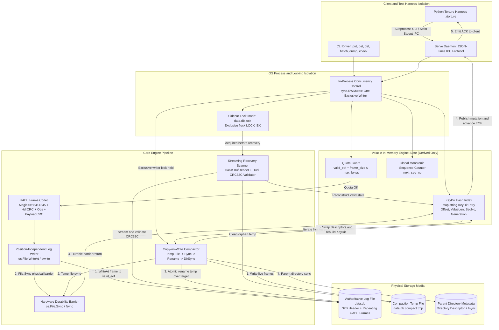
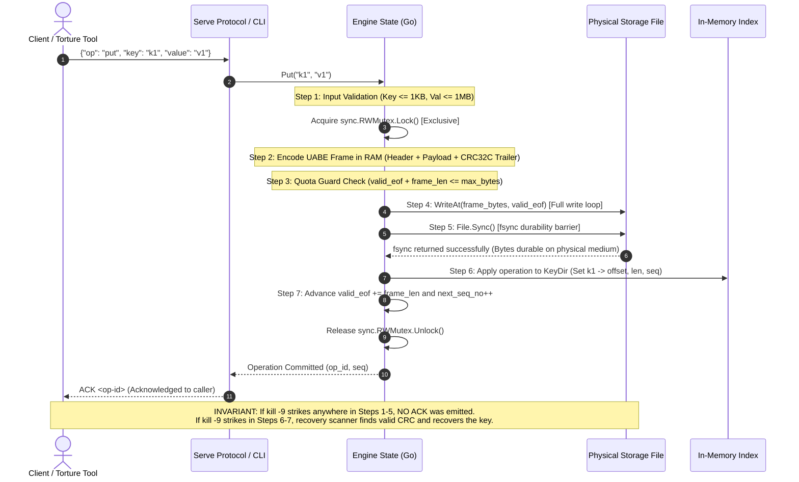
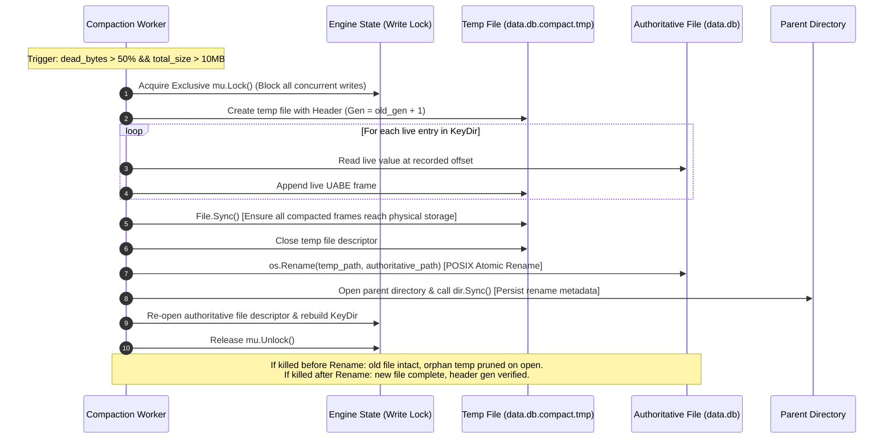
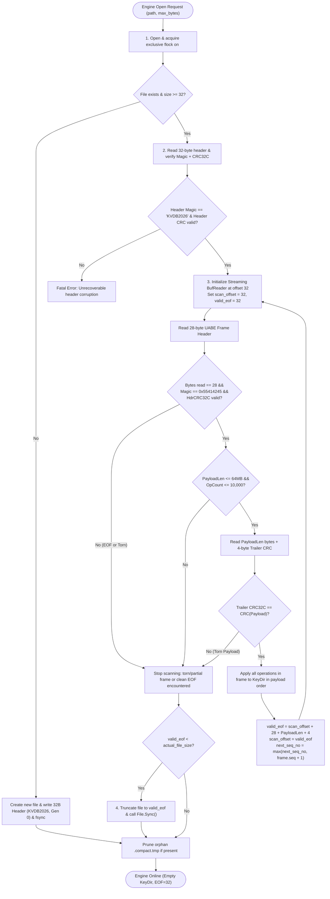
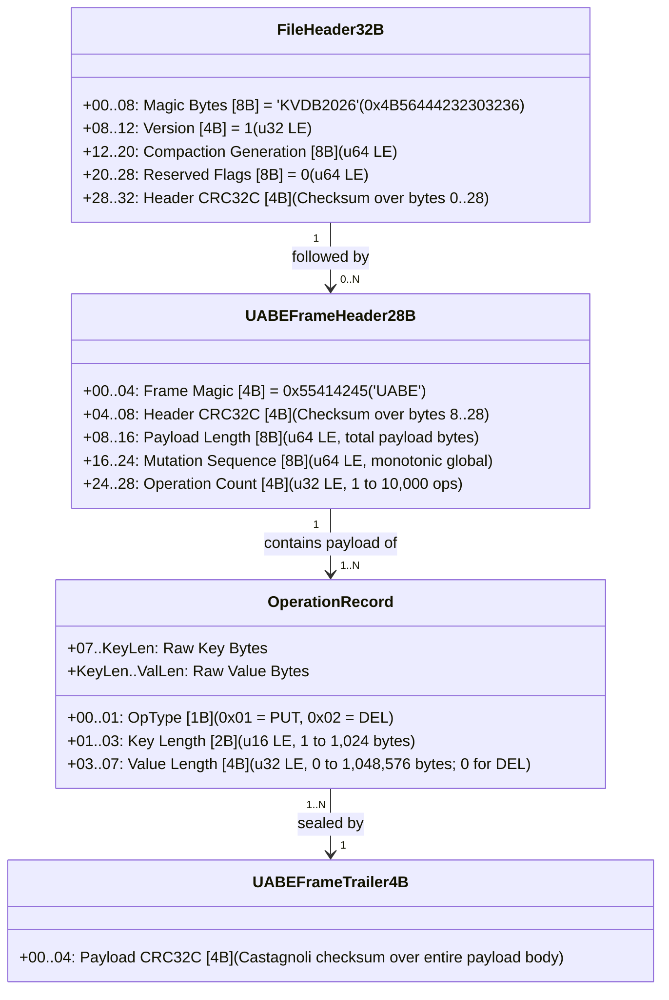

# KVDB System Architecture Diagrams (Deliverable 5)

> **Hackathon:** Kill It and Prove It - 24-Hour Engineering Hackathon  
> **Target:** Go Engine (`./kvdb`) & Python Torture Harness (`./torture`)  
> **Source of Truth:** Section 9A / `docs/common/03_SYSTEM_ARCHITECTURE.md`

---

## 1. Component Map, Concurrency & Ownership Boundaries

---

## 2. Numbered Write & Commit Sequence (Zero Phantom ACK Guarantee)

---

## 3. Compaction Lifecycle & Atomic Swap

---

## 4. Crash Recovery Pipeline Flowchart

---

## 5. On-Disk Binary Specification (Exact Byte Offsets)

